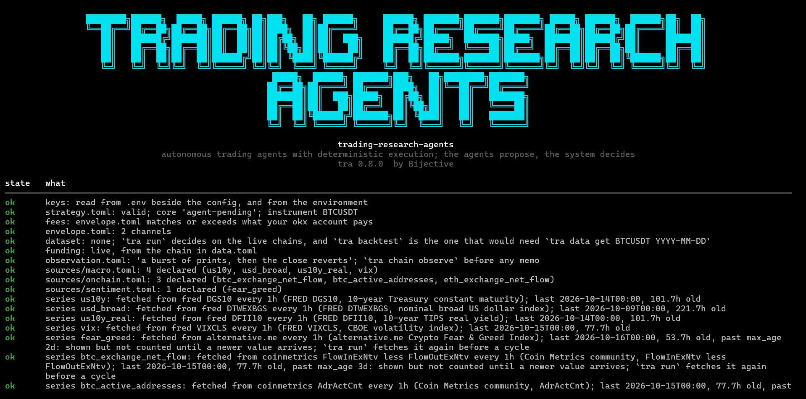
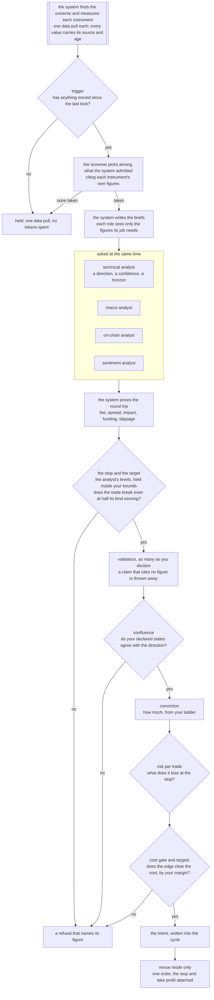

<p align="center">
  <a href="https://www.bijectivelabs.dev"></a>
</p>

<h1 align="center">trading-research-agents</h1>

<p align="center"><strong>Autonomous trading agents with deterministic execution. The agents propose; the system decides.</strong></p>

<!-- mcp-name: io.github.BijectiveLabs/trading-research-agents -->

<p align="center">
  <a href="https://github.com/BijectiveLabs/trading-research-agents/actions/workflows/ci.yml"></a>
  <a href="https://pypi.org/project/trading-research-agents/"></a>
  <a href="https://pypi.org/project/trading-research-agents/"></a>
  <a href="https://github.com/BijectiveLabs/trading-research-agents/blob/master/LICENSE"></a>
  
</p>

<p align="center">
  
  
  
  
  
</p>

<p align="center">
  <a href="https://www.bijectivelabs.dev/open-source"></a>
  <a href="https://docs.bijectivelabs.dev"></a>
  <a href="https://www.bijectivelabs.dev/insights"></a>
  <a href="https://github.com/BijectiveLabs/trading-research-agents/blob/master/CHANGELOG.md"></a>
  <a href="https://github.com/BijectiveLabs/trading-research-agents/blob/master/SECURITY.md"></a>
</p>

<br>

Language models are good at reading a market and saying what they think. They are bad at
arithmetic, they don't know what a trade costs, and they will happily overrule a limit you set.
This project uses them for the first part only. The system itself, fixed rules with no model
involved, fetches the data and works out every figure. The agents read those figures and give an
opinion. Then the system prices the trade, applies your limits, sizes it, and either writes it
down or sends one order with the stop attached. Every decision and every refusal is kept on disk
with its reason, so you can check afterwards what happened and why.

It's an early release, so expect settings to change between versions. What works
today: a universe of perpetuals found and measured by the system, a screener that picks where to
look, the full autonomous cycle on live data, four analysts and up to three validators, stops and
targets the analyst names inside bounds you set, the gates that decide, sizing from your own rules,
real orders on a venue's practice environment behind a mandate you sign, a risk manager that can
only make the desk more careful, and two auditors that read the records.

---

## Contents

- [What it solves](#what-it-solves)
- [Get started](#get-started)
- [What you see, in order](#what-you-see-in-order)
- [How one cycle decides](#how-one-cycle-decides)
- [Venues](#venues)
- [Models and providers](#models-and-providers)
- [Toward real orders](#toward-real-orders)
- [Your money, your orders, your positions](#your-money-your-orders-your-positions)
- [Watching a desk, and what is kept](#watching-a-desk-and-what-is-kept)
- [Command line](#command-line)
- [What it guarantees, and what is not built yet](#what-it-guarantees-and-what-is-not-built-yet)
- [Where it is going](#where-it-is-going)
- [Documentation](#documentation)

## What it solves

| The usual problem with trading agents | What happens here |
|---|---|
| The model invents or miscalculates a number | Models never compute. Every figure comes from the system, and a figure a model cites is checked against its brief, value included. |
| Nobody knows what a trade cost until it's done | The round trip (fees, spread, impact, funding, slippage) is priced before an order exists, and a trade whose claimed edge doesn't clear it is refused. |
| The agent sizes its own position | Size comes from your conviction ladder and your risk limit. No model can make a trade bigger. |
| A model "decides" to ignore your settings | Your declared thresholds decide. A model's opinion is recorded beside them, never instead of them. |
| Something went wrong and there is no trace | Each cycle keeps its snapshot, briefs, answers, the intent and what the venue said. Nothing is rewritten. |
| A crash leaves a position with no stop | The stop and take profit go to the venue attached to the entry, so they survive this process dying. |

## Get started

A few minutes and one model key. Every setting has a working default, so a new desk runs before you
change anything; the table under step 6 says what those defaults are.

**1. Install.** You need Python 3.11 or newer. [uv](https://docs.astral.sh/uv/) is the quickest way:

```bash
uv tool install 'trading-research-agents[ccxt,openai,anthropic,google,data]'
```

That brings every model provider and every exchange in. Without uv, run
`pip install 'trading-research-agents[ccxt,openai,anthropic,google,data]'` inside a virtual
environment. To move to the newest release later:

```bash
uv tool upgrade trading-research-agents      # or: pip install -U 'trading-research-agents[ccxt,openai,anthropic,google,data]'
tra --version
```

That is the release, and the version to run. The `develop` branch on GitHub is where the next
one is built; a commit there is not a release ([more](#where-it-is-going)).

**2. Make a desk.** A desk is a folder holding your settings and everything the agents decide. Name
the provider you have a key for:

```bash
tra init my-desk --profile autonomous --agent groq
cd my-desk
```

| `--agent` | Key in `.env` | Model, when you name none |
|---|---|---|
| `groq` | `GROQ_API_KEY` (free tier) | `openai/gpt-oss-120b` |
| `google` | `GEMINI_API_KEY` | `gemini-flash-latest` |
| `anthropic` | `ANTHROPIC_API_KEY` | `claude-opus-5-5` |
| `openai`, `deepseek`, `xai`, `openrouter`, ... | see [Models and providers](#models-and-providers) | name one with `--model`; `tra models <provider>` lists them |

Add `--venue okx` (or any ccxt id) to trade somewhere other than Bybit.

**3. Add your key.** Copy the example file and put your key in it. Every command reads the `.env`
next to `strategy.toml` on its own.

```bash
cp .env.example .env        # then set GROQ_API_KEY=... in .env
```

**4. Check.** `tra check` reads every setting against the others and names the one thing to fix
next. A desk that is ready ends with:

```
ok    provider groq: ready
ready to run `tra run`
```

**5. Run.** `tra run` decides once on live market data, in the sandbox: nothing leaves your
machine. `tra run --every 15m` keeps deciding, once per fifteen-minute bar, on the clock. Or type
`tra` on its own for the console, which takes the same commands.

```bash
tra run
tra run --every 15m
```

**6. When you want real orders.** Start on the exchange's demo or testnet API:
- put its keys in `.env`;
- read the mandate with `tra mandate`, then sign it with `tra mandate --sign "Your Name"`;
- in `[execution]` of `strategy.toml`, set `mode = "venue"`, a `leverage` and `max_notional` (the
  most one order may be worth).

`tra check` lists whatever is still missing. [Toward real orders](#toward-real-orders) has the
whole path.

**What a new desk does before you change anything**

| | Default | Where to change it |
|---|---|---|
| Orders | none: the sandbox writes each decision down and sends nothing | `[execution].mode` |
| What it trades | BTCUSDT on Bybit, as a taker | `[run].instrument`, `[universe]`, `--venue` |
| Timeframe | decides on 15-minute bars, reads 1h and 4h as context | `[run].bar_interval_s`, `context_intervals` |
| Strategy | none fixed: the analyst picks the setup the measured regime supports, or stays flat | `[agents].mechanism` |
| Stop and target | the analyst names them; the stop is held between 0.2% and 3% and never inside one ATR, the target between 1.5x and 4x the stop | `[exit]` |
| Risk per trade | 0.5% of equity lost at the stop, whatever the stop's distance | `[controls].max_risk_per_trade_bps` |
| Bad days | no new entry after a 3% loss on the day or a 10% fall from the peak | `[controls]` |
| Time limit | a position closes after 4 hours | `[exit].timeout_bars` |
| Trades worth taking | the edge at least 2x the round trip, break even at half the trades or better, at most 6 a day | `[targets]` |
| Oversight | a risk manager that can only cut, pause or halt; two auditors that report | `[audit]` |

Working on the code itself? See [Development](#development).

## What you see, in order

**1. The console.** Run `tra` inside your desk and it opens the console: what is ready, what isn't,
and the next command to run. Under it is a prompt that takes every command and draws it right
there. Arrow keys go back through what you typed, tab completes, `help` lists the commands and
`exit` leaves. For scripts and cron, `tra -c "run --now"` runs one command and exits.



**2. The pass over your instruments.** Type `run --every 15m` and the desk first refreshes any data
series that are due, one line each. Then it looks at every instrument on your list, one data pull
apiece, and measures it. The screen steps through them live:


**3. One cycle per instrument it takes.** The system found the candidates and measured them; the screener
chose among them and cited each instrument's own figures; the system's own order is kept beside the
choice. The instruments taken get a full cycle. The terminal shows the whole pipeline from the
start and updates it as each step begins and ends. Steps that run at the same time spin at the same
time, each with its own clock, and the line underneath says who is working right now:


**4. The result.** When the cycle finishes, the table gives way to the pass over the universe: what the screener took,
what waited and what was held, and why. Then the cycle itself: what the analyst proposed and from
which figures, and every refusal with the number behind it. Here an ETH short in a ranging market
stopped at its exits: with its own stop and target and the round trip, more than half of trades
like it would have had to win just to break even:


Then the data the cycle used and how old it was, the series the reading analysts read, the stop and
take profit it would have placed, and which agents answered. A cycle that goes further adds what
each validator argued, how conviction weighed the analysts, the risk at the stop and the targets:


**5. Between cycles.** The desk says when the next pass is, on the clock and in minutes, for
example `next pass at 14:30:00 UTC, in 10m 57s`, and counts down to it. An auditor woken by an alarm
gets a spinner of its own.

The same cycle as plain text (`--plain`, a pipe or a log), from a real run on live data, shortened:

```
cycle 2026-09-29T02-59-16Z BTCUSDT: 5.344s of agents, 15.042s of validators
  funding        ccxt:bybit         age 4.267s
  ohlcv          ccxt:bybit         age 32.746s
  orderbook      ccxt:bybit         age 7.544s
macro      risk-off: the operator declared a bullish state for US10Y; measured correlation is
           neutral (0.0) on a modest sample, weak evidence that does not overturn the declaration
sentiment  positive: declared state is bullish, and the measured figures both support it
technical: long on range_reversion at 0.65 over 5 bars: the close is stretched low in the window
read: zscore=-0.587, vwap_gap_bps=-3.99, ret_1_bps=1.59
validator contra   oppose on 2 cited figure(s)
validator pro      support on 3 cited figure(s)
conviction: 0.800 of 1.0 (macro 1.0, sentiment 0.5, technical 1.300)
risk: 8.29 bps of equity at the stop against the declared 50 bps, size 0.010
cost: 12.87 bps round trip, 2.00 of it estimated
gate: 25.0000 bps claimed clears 12.8723 bps cost plus 0.0000 bps margin
  refused targets: the claimed edge is 1.94x the round trip and the desk declared 2.0x;
                   the cost is certain and the edge is not
```

That trade was refused. It cleared the cost gate and still died, because this desk asks for an edge
of twice the cost and got 1.94 times. A refusal names the figure behind it, every time.

## How one cycle decides



Who does what:

| Role | Reads | Answers | Can never |
|---|---|---|---|
| technical analyst | candles, spread, funding, book imbalance, open interest change, and the regime on its timeframe and the higher ones you declare | a direction, a setup from a fixed list, a confidence, a horizon, and where its stop and target sit | size the trade, place a level outside your `[exit]` bounds, run a trend setup in a range, or fade a market that is not a measured range |
| macro analyst | dated rates and levels, dated text | risk-on, risk-off or neutral | propose a direction |
| on-chain analyst | chain and derivatives figures | accumulation, distribution or neutral | propose a direction |
| sentiment analyst | dated scores and notes you curate | negative, neutral, positive, or not declared | invent a mood no figure supports |
| market screener | what the system measured for each admitted instrument: move, spread, regime, volume, correlation to BTC | which instruments to take, in what order, citing their figures | add an instrument the system did not admit |
| validators (pro, contra, neutral) | the proposal and the figures behind it | support, oppose or abstain, with cited claims | decide, or cite a figure it wasn't given |
| risk manager | what the run recorded: round trips, the losing streak, your limits, the alarm that woke it | continue, cut the size of new entries, pause instruments, or halt, each for a stated number of hours | loosen a limit you set, or add size |
| technology and quant auditors | the cycles this desk recorded | findings and proposed changes | change anything |

The macro, on-chain and sentiment analysts read dated series you declare under `sources/`. Each one
is either a file you keep or a feed the desk refreshes itself (FRED, the Crypto Fear & Greed Index,
or any paid vendor that answers JSON over https). `tra sources show` lists every series with where it
came from and how old its last value is, and a value older than its `max_age` is shown as stale and
never counted. [Data sources](https://docs.bijectivelabs.dev/opensource/sources) has the details.

Which validators run is yours to declare. A vote never decides on its own: it moves conviction by
the weight you give it (`[conviction].validator_weight`), and a stance counts for what it says beyond
its assignment, since a pro that supports is expected to.

Analysts are allowed to disagree. Each one's view becomes a score between -1 and 1, computed from
its own figures against the lines you drew, so a macro reading barely past its line counts as a small
voice and one far past it counts as a big one. Conviction adds them up: agreement grows the size,
opposition shrinks it in proportion, and only opposition that outweighs the case stops the trade. A
short at 0.70 confidence against a barely bullish macro and sentiment scores 0.56 and trades at half
size; against a strongly bullish context it scores 0 and doesn't trade.

The technical analyst knows what kind of market it is working in before it decides. The system measures
the regime on its timeframe (trending up, trending down, ranging or mixed) and on the higher
timeframes you list in `[run].context_intervals`, and it hands over what your macro thresholds say
this cycle as well. A setup that doesn't fit the regime, such as a trend trade in a sideways
market, is refused by name; `[regime]` holds the lines.

Everything after the analysts is arithmetic over numbers you declared. No model can place, cancel or
resize an order, read a file outside the project, or edit your configuration. [Agents](https://docs.bijectivelabs.dev/opensource/agents) has
the full table of what an agent can reach, and [The cycle](https://docs.bijectivelabs.dev/opensource/cycle) walks through every step.

## Venues

A cycle reaches venues through ccxt, so every exchange ccxt supports is already integrated: the
same order path, the same gates and the same checks, with nothing in the core naming a venue. What
differs from one venue to the next is what ccxt reports it can do, the second column, and how far
it has been tested, the last:

| Venue | What a cycle can do there | Practice environment | Run end to end by us |
|---|---|---|---|
| **Bybit** (the default) | everything: orders with the stop and take profit attached | demo, testnet | **yes**, on the demo API: real orders, exits attached, a resting order cancelled |
| **OKX** | everything | demo (ccxt's testnet switch) | **yes**, on the demo API: real orders, exits attached, closed by the venue's own exits |
| Bitget, BingX, WEEX, BloFin, WOO X | everything | demo or testnet | ready for its run; reports wanted for [Bitget](https://github.com/BijectiveLabs/trading-research-agents/issues/5), [BingX](https://github.com/BijectiveLabs/trading-research-agents/issues/6) |
| Binance, Gate | orders, with the stop and take profit placed right after the fill (`exits = "separate"`) | demo or testnet | ready for its run |
| Hyperliquid, Pacifica, WOOFi Pro, ModeTrade (decentralised) | everything | testnet | ready for its run; [report wanted for Hyperliquid](https://github.com/BijectiveLabs/trading-research-agents/issues/7) |
| KuCoin Futures, Deepcoin | everything | none | integrated; no practice environment |
| dYdX, Paradex, Extended, Lighter (decentralised); Deribit, Crypto.com, Coinbase International | orders, but no exits at the venue through ccxt, and some cannot set leverage | testnet | not for a desk that needs its exits at the venue |
| Kraken, Kraken Futures, Phemex | data for now: ccxt does not report their positions, and no order is sent into a position nobody can see | | |

"Everything" means ccxt reports the five things a safe order needs: send it, attach the exits, read
the position, read the open orders, cancel. "Run end to end" is the stronger claim, a full run
with real orders on the venue's demo or testnet API, and Bybit and OKX are the two that have had it
so far. Any other venue that takes orders can have that run at any time: start on its practice environment, watch a
few cycles and read what it sends. Each report moves a venue into the last column.

Adding the venue you trade on is four steps, and one command writes most of it:

```bash
tra venues okx            # what it can do, and which keys it signs with
tra venues okx --setup    # the blocks to paste into envelope.toml, data.toml, strategy.toml and .env
```

Your fees are filled in from your account when it reports them, and from the venue's standard
tier until then, labelled as such; a fee you write yourself is kept and checked against the account. [Venues](https://docs.bijectivelabs.dev/opensource/venues) has the full table, the keys each
venue needs, and the four steps.

## Models and providers

You choose the provider and the model; nothing is hard-coded. Each provider reads its key from the
environment (or the `.env` beside your config) and nowhere else.

| Provider | Key in `.env` | Install with | Structured output | Tested live here |
|---|---|---|---|---|
| `groq` | `GROQ_API_KEY` | `openai` | JSON schema, falling back to JSON mode; checked by the system | **yes**: `openai/gpt-oss-120b` and `openai/gpt-oss-20b`, every live cycle in our records |
| `google` | `GEMINI_API_KEY` or `GOOGLE_API_KEY` | `google-genai` | JSON schema | **yes**: `gemini-flash-latest`, as the fallback |
| `anthropic` | `ANTHROPIC_API_KEY` | `anthropic` | JSON schema | unit-tested; default model `claude-opus-5-5` |
| `openai` | `OPENAI_API_KEY` | `openai` | strict JSON schema | unit-tested |
| `deepseek` | `DEEPSEEK_API_KEY` | `openai` | JSON mode | preset only |
| `mistral` | `MISTRAL_API_KEY` | `openai` | JSON schema | preset only |
| `xai` | `XAI_API_KEY` | `openai` | JSON mode | preset only |
| `openrouter` | `OPENROUTER_API_KEY` | `openai` | JSON mode | preset only |
| `qwen` | `DASHSCOPE_API_KEY` | `openai` | JSON mode | preset only; pass `--base-url` for your region |
| `ollama` | none | `openai` | JSON mode | preset only; a local server |
| `local` | none | `openai` | JSON mode | any OpenAI-compatible server; pass `--base-url` |
| `9router` | `9ROUTER_API_KEY` | `openai` | JSON schema | preset only; a local router |

Whatever the provider, every answer is parsed against a closed schema by the system before anyone reads
it, so a model that only offers JSON mode is held to the same shape as one with strict schemas.

```toml
[agents]
provider = "groq"
model = "openai/gpt-oss-120b"
effort = "medium"                    # minimal | low | medium | high | xhigh | max, where the
                                     # vendor takes it; left out, the vendor's default applies
fallback = ["google:gemini-flash-latest", "anthropic:claude-opus-5-5"]

[agents.roles.sentiment_analyst]     # a role that only labels can run on a cheaper model
model = "a-cheaper-model"
effort = "low"
```

`fallback` is tried in order when a provider is rate limited or down, with the same brief. A vendor's
free tier meters each model on its own, so roles can share a provider across two models and each
model keeps its own allowance; `tra check` judges the load per model and says when one is too much. Every
call is a line in `usage.jsonl` with its tokens and latency, and nothing caps spend unless you
declare a ceiling. `tra keys --probe` proves each key works without sending a prompt. A vendor of
your own is about thirty lines ([Model providers](https://docs.bijectivelabs.dev/opensource/providers)).

## Toward real orders

What it trades today: **linear perpetual futures** (USDT- or USDC-margined swaps) on any venue
ccxt reaches, long and short, with the leverage and margin mode you declare. That is where the
project started, not where it stops. Spot is built too, long only and paid in full, for a desk
that lists it in `[execution].markets`; [Venues](https://docs.bijectivelabs.dev/opensource/venues#where-an-order-goes-and-what-an-instrument-is)
says how to set one up. Stock perpetuals and tokenized stocks on the same venues go through the
same path, with the underlying exchange's hours respected, and so do prediction market outcomes,
decided on a probability by their own analyst. Dated futures, inverse contracts and options are on
the way, each with its own cost model, exit rules and tests. Until a market type has those, venue
mode checks the type on every order and refuses it, because a market the system cannot yet price
and protect is not one it should send to. [Boundaries](https://docs.bijectivelabs.dev/opensource/boundaries) says what each one takes.

An agent desk goes through three steps, and you can stay at any of them as long as you like:

| Step | How | What happens | Needs |
|---|---|---|---|
| 1. Sandbox | `tra run` | the full cycle on live data; every decision written down, no order sent | a model key |
| 2. Demo or testnet API | `tra run` with `[execution].mode = "venue"` and `environment = "demo"` or `"testnet"` | real orders on the exchange's demo or testnet API, exits attached, positions looked after | a signed mandate, a leverage, `max_notional`, practice keys |
| 3. Real capital | the same, with `environment = "mainnet"` | real orders with real money | all of the above, plus the ladder at its canary tier (`tra ladder promote`, with evidence) |

Steps 1 and 2 have been run end to end on Bybit's and OKX's demo APIs. Step 3 has not
been run by us; treat it as yours to verify, small, first.

If you bring a scripted strategy of your own instead of the agents, it has a research path of its
own before any of this: `tra data get BTCUSDT 2025-01-01` and `tra backtest` replay a day of the
exchange's archive net of every cost, `tra paper --minutes 30` runs it on the live feed with
nothing sent, and `tra live` is a small canary session behind hard caps. The replay of that day
printed `net -294.19 bps` for the example core, and it is shown as it came out: a backtest that
only shows good news is one nobody should believe. [The live tier](https://docs.bijectivelabs.dev/opensource/live)
has the details.

Venue mode is the only mode that can lose money, so it has a door in front of it. Read the
mandate with `tra mandate`; when you accept it, `tra mandate --sign "Your Name"` keeps it in the
project as `MANDATE.md` and signs `[execution]` with your name and today's date, in one step.
Signing does not switch anything on. `tra check` names whatever else is missing.

### Your money, your orders, your positions

Once orders flow, three things look after the money, all of them the system's own rules and none of them a model:

| Before an order | When it is sent | While it is open |
|---|---|---|
| the account's real equity and free margin are read | your leverage is applied at the venue and read back | at the start of every pass, each position is checked against the venue |
| sizing uses the smaller of the real equity and what you allow the desk | an order whose liquidation would sit inside its stop is refused | one that outlives its hold limit is closed with a reduce-only order |
| an order may use only part of the free margin | a taker entry is a limit IOC within your slippage band, never a naked market order | one the venue's stop or take profit closed is written up with its real fees and funding |
| a day's loss past your limit stops new entries | the stop and take profit go with the entry, so they outlive this process | the kill switch flattens everything before the desk stops |

Who decides what, in one line each: **the analysts propose the direction, your risk rule sets the
size, you choose the leverage, and no model touches the last two.** Leverage never makes a trade
bigger. It only decides how much margin the trade ties up and how far away liquidation sits.

```toml
[execution]
mode = "venue"
environment = "demo"             # demo | testnet | mainnet
leverage = 3                     # yours to choose; it never makes a trade bigger
max_notional = 400               # the most one order may be worth, in quote currency
margin_mode = "isolated"         # isolated | cross
hold_limit = "timeout"           # close by time after [exit].timeout_bars; or horizon, or none
```

Underneath, on every venue: the order goes only to the environment you declared (demo, testnet or
mainnet); an open position or a working order refuses a second entry; a size off the venue's step is
refused rather than rounded; a clock more than a second off the venue's refuses before anything is
signed; and Ctrl-C or a service stop cancels a resting order before the process leaves. Every close
goes to `positions.jsonl` and every finished trade to `round_trips.jsonl`. [Capital, orders and positions](https://docs.bijectivelabs.dev/opensource/capital) has
every setting, every refusal and the arithmetic behind each one.

One thing to know before you rely on it: the position checks run at the start of each pass of
`tra run --every`. With no desk running, an open position has its venue-side stop and take profit
and nothing else, so a desk meant to run unattended belongs under a supervisor.

Orders cross the book by default (`taker-taker`): they always fill, which is how most desks trade.
Point `[run].venue_key` at a `maker-taker` channel and entries rest on the book as post-only orders
instead - a lower fee, fewer fills, since a resting order can be left behind by the market. Either
way the cost gate prices the fee of the channel you chose.

## Watching a desk, and what is kept

The console runs commands in its own process, so closing it ends what it was running. A desk that
should keep running belongs under a supervisor (systemd, a service manager, `tmux`), and then you
look at it from anywhere with:

```bash
tra watch --every 5s       # a read-only view built from the records the desk writes
```

`tra watch` opens no connection, holds no key and takes no lock, so opening and closing it does
nothing to the desk.

What is kept, and where:

| What | Where | Notes |
|---|---|---|
| everything one cycle did | `runs/cycles/<id>/` | snapshot, briefs, answers, intent, `placed.json`, `cycle.json`, and `inputs.json.gz` with the raw inputs; `cycle.json` holds a sha256 of each file |
| the pass over the universe | `runs/screens/` | every instrument measured, what the screener chose and why |
| every model call | `runs/cycles/usage.jsonl` | tokens, latency, price |
| when the desk ran and what stopped it | `runs/cycles/scheduler.jsonl` | one line per start and stop |
| every position closed, by time, by the venue or by the kill switch | `runs/cycles/positions.jsonl` | venue mode |
| every finished trade with entry, exit, fees and funding | `runs/cycles/round_trips.jsonl` | venue mode; what the quant auditor reads |
| the first equity reading of each day | `runs/cycles/equity.jsonl` | what the daily loss limit is measured from |
| what you typed at the prompt | `.tra-history` | a convenience only; `tra -c` keeps none |

## Command line

Every command says what it did. Exit code 0 means cleared, 1 means a gate said no, 2 is a usage
error. `--json` gives machine-readable output and `--plain` gives text instead of panels.

**Getting started**

| Command | What it does |
|---|---|
| `tra` | opens the console |
| `tra init my-desk --profile autonomous` | a project wired for the agents, every file commented |
| `tra check` | every setting read against the others, with what to fix |
| `tra keys --probe` | proves every key works; no key is printed, no prompt or order sent |
| `tra models groq` | the models your key can use on a provider, read from the vendor; no prompt sent |
| `tra init my-desk --profile autonomous --venue okx` | a desk wired for one exchange: data, orders, demo or testnet API, keys |
| `tra venues` | every venue the docs describe, and what each can do |
| `tra venues okx --setup` | what a venue can do, and the blocks to paste to trade on it |
| `tra mandate` | the text venue mode requires; `--sign "Your Name"` keeps it as `MANDATE.md` and signs `[execution]` in one step |

**Running**

| Command | What it does |
|---|---|
| `tra run` | one autonomous cycle |
| `tra run --every 15m --cycles 12` | twelve scheduled passes: the first now, then one on every fifteenth minute of the clock |
| `tra run --now` | ask the roster even if the trigger would have held a quiet market |
| `tra watch --every 5s` | a read-only view of a running desk |
| `tra audit` | both auditors over the records; nothing is applied |
| `tra backtest`, `tra paper`, `tra live` | replay, shadow, canary |

**Data**

| Command | What it does |
|---|---|
| `tra data get BTCUSDT 2025-01-01` | download a day, verify its checksum, audit it, write Parquet and funding |
| `tra data audit export.csv --mapping mapping.toml` | your own CSV, through the same audit |
| `tra data pull BTCUSDT` | one live snapshot through the chains in `data.toml` |
| `tra sources show`, `tra sources pull` | where the reading analysts' series come from and how old they are; refresh them now |
| `tra sources add macro us10y --from fred --id DGS10 --high bearish` | a series onto the shelf in one step: pulled now, its lines drawn from its own history |
| `tra universe` | which perpetuals discovery finds on the venue now, and what each filter took out |
| `tra runs verify` | every cycle's files against their hashes, and its briefs against its raw inputs |
| `tra runs prune --keep 90d` | what old cycle directories would be removed; add `--yes` (and `--archive`) to do it |

**The ladder, research and hosts**

| Command | What it does |
|---|---|
| `tra ladder show`, `promote`, `demote` | which tier the desk stands at; one step up with evidence, or down |
| `tra chain floor`, `observe`, `check`, `validate` | the research chain, layer by layer ([The falsification chain](https://docs.bijectivelabs.dev/opensource/chain)) |
| `tra ledger show` | every idea that died, and what killed it |
| `tra agent session`, `eval`, `trace` | the research session, model comparison, a run read back |
| `tra mcp serve` | the read-only gates as tools for any MCP host |

## What it guarantees, and what is not built yet

Some rules are guarantees, enforced by the system and tests, and every change has to keep them:

- **No model touches an order or a key.** Models read figures and answer; the system sizes, prices,
  limits and sends.
- **No model can loosen a control.** A model can tighten a limit, step the ladder down or arm the
  kill switch; never widen, promote or disarm.
- **One decision, at most one order.** A venue error is recorded and the next cycle decides again;
  nothing is retried around real capital.
- **Stale or missing data is refused,** never read as zero or as current.

Other things are simply not built yet, and contributions are welcome: inverse, dated futures and
options; on-chain venues outside ccxt; more than one account; transfers and treasury; routing
and execution algorithms; portfolio accounting. [Boundaries](https://docs.bijectivelabs.dev/opensource/boundaries) lists each one with what it does
today and what a contribution would need. The example strategy cores are examples: your edge is
yours to declare.

[Liability](https://docs.bijectivelabs.dev/opensource/liability) says plainly where responsibility sits when real capital is involved.

## Where it is going

The project is in active development, and what this page describes is where it stands today, not
where it stops.

- **More market types.** Spot, stock perpetuals, tokenized stocks and prediction markets are
  built; inverse and dated futures and options follow, each added with its own cost model, exit rules,
  sizing and tests before venue mode accepts it.
- **More venues run end to end.** Every venue ccxt supports already goes through the same order
  path and gates. Each one joins Bybit and OKX in the last column of the venues table after a full
  run on its demo or testnet API, ours or yours.
- **The rest of the not-built-yet list,** one piece at a time, without weakening a guarantee.

**Use the release.** What PyPI installs is the latest release, and it is the version to run.
Releases come from `master`. The `develop` branch is where the next release is built: it moves
often, a commit there is not a release, and it can carry work that is unfinished or changed again
before it ships. A set of changes becomes a release when it is merged into `master`, tagged and
published, and [CHANGELOG.md](https://github.com/BijectiveLabs/trading-research-agents/blob/master/CHANGELOG.md) says what each one brought.

## Documentation

The full documentation is at [docs.bijectivelabs.dev](https://docs.bijectivelabs.dev). Its source is in
`docs/`, so a change in behaviour and the page that describes it go in the same pull request.

| Read this | For |
|---|---|
| [The cycle](https://docs.bijectivelabs.dev/opensource/cycle) | the cycle step by step, and every setting that shapes it |
| [Agents](https://docs.bijectivelabs.dev/opensource/agents) | each role, what it reads, and what an agent can and cannot reach |
| [Data sources](https://docs.bijectivelabs.dev/opensource/sources) | where the macro, on-chain and sentiment figures come from, fetching them, and freshness |
| [Capital, orders and positions](https://docs.bijectivelabs.dev/opensource/capital) | equity, margin, leverage, liquidation, daily loss, time exits, the kill switch, and the records they leave |
| [Venues](https://docs.bijectivelabs.dev/opensource/venues) | which venues work, and adding yours |
| [Working with language models](https://docs.bijectivelabs.dev/opensource/llm), [Model providers](https://docs.bijectivelabs.dev/opensource/providers) | how models are used: fallback, spend, adding a provider |
| [The live tier](https://docs.bijectivelabs.dev/opensource/live), [The trading agent](https://docs.bijectivelabs.dev/opensource/trading) | the ladder from replay to a live session |
| [The data gate](https://docs.bijectivelabs.dev/opensource/data) | the data gate, and bringing your own data |
| [Boundaries](https://docs.bijectivelabs.dev/opensource/boundaries), [Liability](https://docs.bijectivelabs.dev/opensource/liability) | what is guaranteed, what is not built yet, and who is responsible |
| [The agent](https://docs.bijectivelabs.dev/opensource/agent), [The MCP server](https://docs.bijectivelabs.dev/opensource/mcp) | the research agent, and the MCP server |
| [Architecture](https://docs.bijectivelabs.dev/opensource/architecture) | packages, import rules, file formats |
| [The falsification chain](https://docs.bijectivelabs.dev/opensource/chain), [Execution realism](https://docs.bijectivelabs.dev/opensource/execution), [The kill ledger](https://docs.bijectivelabs.dev/opensource/ledger) | the research chain, execution realism, verdicts |
| [Command line](https://docs.bijectivelabs.dev/opensource/commands) | every `tra` command |
| `CHANGELOG.md` | what changed |

## Development

```bash
git clone https://github.com/BijectiveLabs/trading-research-agents && cd trading-research-agents
uv sync --all-extras
uv run ruff check . && uv run ruff format --check .
uv run mypy
uv run pytest
```

[CONTRIBUTING.md](https://github.com/BijectiveLabs/trading-research-agents/blob/master/CONTRIBUTING.md) has the branch flow and the standards the code is held to.

## Where it comes from

This repository opened to the public in October 2026. Its history starts on 12 September 2026,
when the code was separated from Bijective's internal work, and every commit, tag and contributor
since then is here. The ideas it is built on are older: the falsification chain, the cost model and
the controls in front of every order come from Bijective's research and from the trading platform
it was building before this repository existed. The language-model agents came later and sit on top
of those gates, which is why they can propose but never size, price or send.

## License

MIT. See [LICENSE](https://github.com/BijectiveLabs/trading-research-agents/blob/master/LICENSE); [NOTICE](https://github.com/BijectiveLabs/trading-research-agents/blob/master/NOTICE) lists the third-party software this package builds on.

Built by [Bijective Labs](https://github.com/BijectiveLabs).
