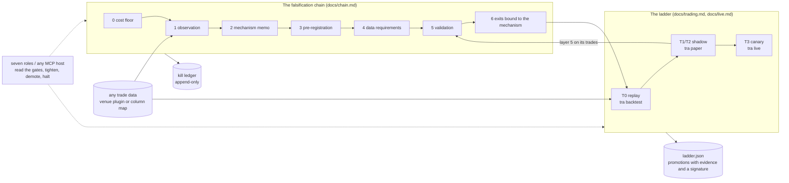
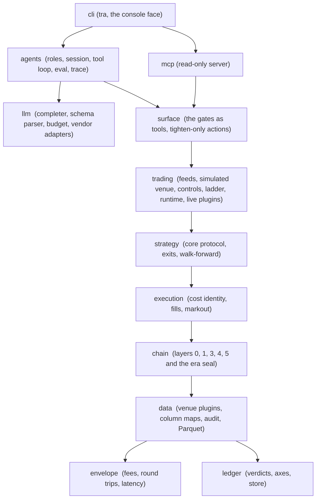

# trading-research-agents

**Autonomous trading agents for crypto that cannot lie about their own results.**

Agents that decide, and code that refuses. An engine pulls the data, normalises it, and hands
each agent a brief of figures the agent did not compute itself. Models read those figures and
decide. Then code takes over: it prices the round trip before the order exists, enforces the
limits you declared, and writes every intent, refusal and fill to a ledger that is never
rewritten. No model sits on the order path, no agent holds a key, and the default venue is a
simulator. What survives that is worth looking at; what does not is recorded as dead, with the
reason it died.

Status: pre-release, under active development. The API is not stable and the package is not
yet on PyPI. Running today: the gates, the ladder, the roles, the console. Landing next: the
autonomous cycle, live data sources with free and paid chains, the validators, and the two
auditors.

---

## One cycle

```bash
pip install 'trading-research-agents[ccxt,openai,data]'
tra init my-desk --profile autonomous && cd my-desk   # the cycle, wired, commented line by line
cp .env.example .env                # your model key; no venue key is needed for a cycle
tra run --env-file .env             # one autonomous cycle, in the sandbox
```

```
snapshot (engine)  ->  briefs (code)  ->  agents (parallel)  ->  cost gate (code)  ->  intent or refusal
```

What that prints, from a real cycle on live data with a real model:

```
cycle 2026-09-27T14-51-23Z BTCUSDT: 8.46s of agents
  funding        ccxt:bybit         age 0.764s
  ohlcv          ccxt:bybit         age 35.705s
  orderbook      ccxt:bybit         age 5.303s
technical: long at 0.68 over 3 bars: short-horizon reversion of the close against its window
           triggered by a zscore of -2.197, vwap_gap_bps of -24.21 and volume_ratio 2.392
cost: 13.48 bps round trip, 2.00 of it estimated
gate: 25.0000 bps claimed clears 13.4800 bps cost plus 0.0000 bps margin
the edge is declared: [agents].magnitude_bps, declared by the operator and not measured here
  fee_round_trip        11.0000 bps  declared
  spread_cost            0.0118 bps  measured
  impact                 0.0000 bps  computed
  funding_accrual        0.4682 bps  declared
  latency_slippage       2.0000 bps  estimated
intent: long 0.01 (sandbox)
```

Three things in that output are the whole argument of this project. The model never computed a
number: every figure it read was built by code from a snapshot that says how old it is. Eleven of
the thirteen basis points of cost are the venue's own fee schedule, printed before any order
exists. And the claimed edge is labelled a declaration, because it has not been measured yet.
`docs/cycle.md` is the rest of it.

## Four commands

```bash
pip install 'trading-research-agents[data]'     # numpy and pyarrow; nothing else
tra init my-run && cd my-run                  # strategy.toml, envelope.toml, an example core
tra data get BTCUSDT 2025-01-01               # fetch, audit, Parquet and funding, into data/
tra backtest                                  # the example core on that day, net of costs
```

`tra check` says what is ready and what is still missing, in plain words, before you run.
Every file `tra init` wrote is commented line by line; nothing in the logic is a constant.
To make a model the decision core instead of a code core:

```bash
tra init my-run --agent deepseek --model deepseek-flash   # any provider in docs/providers.md
cp .env.example .env                                      # and put the key in it
tra backtest --env-file .env                              # or: tra agent session
```

The same four commands take you to paper (`tra paper`) and, behind the ladder, to a canary
session on a live venue (`tra live`, `docs/live.md`). Total time from install to a first
backtest is a few minutes, most of it the download.

## Why this exists

Most trading-agent frameworks are good at producing a decision and silent about whether the
decision was earned. They do not carry a cost model, they do not hold out data, and they
cannot tell you which of their past calls were wrong and why.

This project starts from the opposite end. It is built on a research programme that closed
thirty hypotheses in four months without committing capital to any of them, and wrote down
what each one died of. The agent inherits that discipline as code:

- **Cost first.** A 3.0 bps signal with a p-value of zero is dead against a 9.0 bps round trip.
  That comparison is layer 0 and it runs before anything else.
- **Net from day one.** Fees, spread, slippage and funding are in every figure. Gross is
  reported, labelled, and never carries a verdict.
- **Power before verdict.** An underpowered result is `NOT PROVEN`, not `FALSIFIED`. The two
  are enforced as different words because the difference is a closed branch nobody closed.
- **Reversal points.** A verdict blocked by fees records the fee at which it reverses, so a
  reader with a better schedule reuses the work instead of repeating it.
- **Fewer agents, more gates.** Language models write the mechanism memo, the falsifiable
  claim and the exit design. The arithmetic and the statistics are code, and cannot be argued
  with.

Two required dependencies, `numpy` and `rich`. No orchestration framework, no dataframe
library, no vendor lock-in. Everything that touches money is `Decimal`; the statistics run in
floating point from the collapsed series on.

## How it fits together



An idea enters at layer 0 and dies at the cheapest layer that can kill it; what survives is
a decision core the same runtime takes from replay to a capped live session, one tier at a
time; the ledger records every death, the ladder every promotion. Models sit on the surface:
they read what the gates measured and can only tighten what code enforces.



Imports go downward only, and a test enforces it (`tests/test_boundaries.py`). `llm` is the
only package that speaks to a model vendor, and it knows nothing about markets; `agents` is
the only package that speaks to `llm`. Only the plugin directories, and the files `tra init`
copies, name a venue.

## What is here today

| Package | Purpose |
|---|---|
| `trading_research_agents.ledger` | The kill ledger: a closed vocabulary of verdicts and axes, an append-only store, and the consistency rules between them |
| `trading_research_agents.envelope` | The operating envelope: fees per channel, measured round trips, latency. Configuration, never constants |
| `trading_research_agents.data` | The data gate: any trade data to canonical trades, through a venue plugin or a declared column map; a one-pass audit with findings, a manifest with checksums, and exact `DECIMAL` Parquet with the `[data]` extra |
| `trading_research_agents.data.sources` | Live sources behind a chain: free before paid, failover recorded, a time to live per kind, and provenance on every value. `ccxt:<venue>` reads public endpoints of more than a hundred venues and is never given a key |
| `trading_research_agents.strategy` | The decision-core protocol, exits bound to the mechanism (layer 6, causal stops with adverse fills), the walk-forward harness that refuses precomputed parameters. No strategy of its own |
| `trading_research_agents.trading` | The trading agent: recorded feeds and live feed plugins, a simulated venue on the execution rules, controls that fail closed, the promotion ladder, one runtime for replay and shadow |
| `trading_research_agents.store` | What a run remembers: the snapshot a cycle is decided from with provenance and age on every value, the cycle directory an auditor replays, and a cache that only returns what is still fresh |
| `trading_research_agents.llm` | Everything that talks to a language model and nothing that decides: the completer protocol, the structured-output parser, the call budget with `usage.jsonl`, and the vendor adapters behind `[anthropic]`, `[openai]`, `[google]` plus verified OpenAI-compatible presets |
| `trading_research_agents.agents` | The roles: what each agent is asked, what it may answer, and what it may never do. Seven today (screener, technical analyst as a decision core, macro, on-chain, risk manager, executor, auditor) in a fixed session, a bounded tool loop, model comparison, and traces |
| `trading_research_agents.surface` | The gates as callable tools for the MCP server and the roles: ten reads, and actions that only tighten, demote or halt |
| `trading_research_agents.cli` | The `tra` command: run, data, chain, agent, trade, ladder, ledger, and the console face |
| `trading_research_agents.chain` | The falsification chain: layer 0 (cost floor), layer 1 (market observation), layer 3 (sealed pre-registration), layer 4 (data requirements), layer 5 (validation: net returns, block bootstrap, matched null, subperiods, power, BH, anchor robustness), and the era seal |
| `trading_research_agents.execution` | Execution realism: the cost identity with funding, walk-the-book, passive fills with trade-through, effective cost across unfilled orders, markout, and the pre-trade cost a cycle is gated on |

Layer 0 in six lines:

```python
from decimal import Decimal
from trading_research_agents.envelope import load_envelope
from trading_research_agents.chain import cost_floor

envelope = load_envelope("examples/envelope.toml")
check = cost_floor(envelope, Decimal("3.0"), venue="hyperliquid")
print(check.outcome, check.margin_bps)
```

A stop at layer 0 becomes a `CLOSED` row on the cost axis, envelope-bound, with the reversal
point recorded. A pass records nothing, because clearing the cheapest test is not a verdict.

## Command line

The same gates from a shell. Exit code 0 means the gate was cleared, 1 means it said no, 2 is
a usage error; add `--json` to any command for machine-readable output.

```bash
tra data get BTCUSDT 2025-01-01                 # fetch + audit + Parquet + funding
tra check                                        # what is ready, what is missing
tra data fetch --venue binance --instrument BTCUSDT --month 2025-01 --out data/
tra data audit data/BTCUSDT-trades-2025-01.zip --venue binance --instrument BTCUSDT \
    --max-gap 5m --manifest data/manifest.json
tra data audit export.csv --mapping examples/mapping.toml --instrument BTCUSDT --max-gap 5m
tra data pull BTCUSDT                            # one live snapshot through the chains in data.toml
tra run --env-file .env                          # one autonomous cycle; docs/cycle.md
tra chain floor --envelope examples/envelope.toml --magnitude 3.0 --venue hyperliquid     --subject "informed-flow burst drift" --ledger ledger.jsonl --id H-001
tra chain observe --dataset data/BTCUSDT-2025-01-01.parquet   # layer 1: does the event recur? observation.toml
tra chain check preregistration.json
tra ledger show
tra agent propose --idea "Longs paying high funding get squeezed into settlement"     --envelope examples/envelope.toml --provider anthropic
tra agent refusals
tra chain requirements --registration runs/<id>/preregistration.json --manifest data/manifest.json
tra chain validate --registration runs/<id>/preregistration.json --trades trades.jsonl \
    --cost-bps 15.0 --block-length 7 --ledger ledger.jsonl --id V-001
tra init my-run                                  # or: --agent deepseek --model deepseek-flash
tra backtest                                     # config, envelope, dataset, out: by convention
tra paper
tra ladder promote --evidence "layer 5 OPEN on backtest-1" --signed-by operator
tra data funding --venue bybit --instrument BTCUSDT --from 2025-01-01 --to 2025-01-31 \
    --out funding.json
tra live --env-file .env                        # canary tier, behind the ladder; docs/live.md
tra mcp serve                               # the read gates for any agent host; docs/mcp.md
tra agent session --env-file .env               # the seven roles over data/; docs/agents.md
tra agent eval --model groq:openai/gpt-oss-120b --model deepseek:deepseek-flash --env-file .env
tra agent trace runs/session-1                  # the record of a run or a session, in order
```

`data fetch` streams the archive to a `.part` file, hashes it as it arrives, and keeps it only
if the size and, where the venue publishes one, the checksum agree. `data audit` refuses a
dataset the way the gate would, and writes the manifest with the finding either way. A venue
is a plugin (`docs/venues.md`); data from anywhere else comes through a column map.

## Common conventions

The spellings people expect are the tiers of the ladder: `tra backtest` is `trade replay`
(T0), `tra paper` is `trade shadow` (T1/T2), `tra live` is `trade live` (T3, canary). `tra
init DIR` writes a project: `strategy.toml`, `envelope.toml`, `mapping.toml`, `data.toml`, the
`sources/` shelf, an example core beside the config, `.env.example`, `.gitignore`. The shelf is one
declaration per class of data (macro, news, sentiment, on-chain, derivatives), shipped as forms with
the entries commented out: fill one in and the analyst that reads it joins the roster, leave it and
that role is never asked. Inside a project the run commands need no
flags: `strategy.toml` and `envelope.toml` from the directory, the newest dataset in `data/`,
funding beside it, a run directory under `runs/`. Every flag still exists for anyone who wants
it elsewhere. Keys come from the environment (`BYBIT_API_KEY`, `BYBIT_API_SECRET`) or an
explicit `--env-file`; nothing is read silently.
Venues, feeds and live adapters register through entry points. The MCP server behind the
`[mcp]` extra exposes the gates as read-only tools to any host.

At a terminal, `tra` alone shows what is ready and the one command to type next; a run shows
a live panel of bars, intents, fills and net basis points, a session shows each role as it
runs, and every report is a table. The figures are the same ones the plain output carries:
`--json` is untouched, and `--plain` (or `TRA_PLAIN=1`, or a pipe) gives the text form.

## What the package does not contain

`docs/boundaries.md` is the full statement of where this software stops and why: one order per
decision and no retries, no routing or execution algorithms, no account or treasury operations, no
DEX execution (a chain can be priced, not traded), no optimiser in the research chain, and no model
that can size a trade or change a file. Every line of it is a decision rather than an oversight, and
each one says what to do instead. The short version:

- **A strategy.** The mechanism ships (the protocol, the exits, the walk-forward harness); the
  cores in `examples/strategies/` are examples of it, measured and closed in the research it
  descends from, and a run points at them by file like it would at your own.
- **A venue.** The two that ship are plugins found through the same registry as a
  third-party one. Nothing in the gates names a venue, and a test fails the build if it does.
- **A data vendor.** Any CSV with a declared column map goes through the same gate.
- **A model that can loosen a control.** Agents have full access to data, gates and, as the
  technical analyst, to the decision on each bar; the limits, the caps, the ladder and the kill
  switch are code that a role can only tighten, step down or arm. The MCP server has no tool
  that trades, promotes or records. `docs/liability.md` says where the responsibility sits.
- **A production tier.** Real orders exist at canary only, with hard caps, behind a ladder
  that needs evidence and a signature at every step and refuses production outright.
- **A book to manage.** This project executes one decision; a trading platform manages a
  portfolio across venues over time. Keeping the two apart is what lets this one stay small
  enough to read.

## Roadmap

| Release | Adds |
|---|---|
| 0.1 | Ledger, envelope, layer 0, pre-registration with numeric kill criteria, public-archive ingestion and dataset audit for two venues, `tra` CLI |
| 0.2 | The agent: bound, mechanism memo with a critic, and pre-registration drafted by a language model, validated by the existing gates, recorded to the ledger; bounded revision loop; Anthropic and OpenAI adapters |
| 0.3 | Execution realism: cost identity, latency-shifted fills, trade-through matching, fill probability, markout; layers 4 and 5 with the era seal |
| 0.4 | The trading agent: layer 6 exits, walk-forward harness, replay and shadow on one code path, controls, ladder, a live public feed (`[shadow]`) |
| 0.4.1 | Adoption rules: no strategy in the core, venues as plugins with entry points, any data through a column map |
| 0.5 | The canary tier: a live venue plugin behind a security review that runs as tests, hard caps, the ladder gate; funding as charged; MCP server exposing the read gates to any agent host; `tra init`, `backtest`, `paper`, `live` |
| 0.6 | Agents with full access through the gates: seven roles in a fixed session, the technical analyst as a metered decision core, providers as plugins with verified presets, `usage.jsonl`; the bounded tool loop, resume, eval and trace; layer 1 of the chain; the console face |
| 0.7 | Production tier behind an operational runbook; private execution stream; maker channels; a second live venue |

Crypto perpetuals first. The core vocabulary is market-agnostic (`venue`, `instrument`,
`session`), but every number in the gates was measured on crypto venues and nothing is promised
for other markets until it has been measured there too.

## Development

```bash
uv sync
uv run ruff check . && uv run ruff format --check .
uv run mypy
uv run pytest
```

See `CONTRIBUTING.md` for the branch flow and the standards the code is held to,
`docs/boundaries.md` for where this software stops and why, `docs/architecture.md` for the package
boundaries and the file formats at them, `docs/data.md`
for the data gate, `docs/cycle.md` for the cycle, `docs/chain.md` for the chain, `docs/execution.md` for execution realism,
`docs/agent.md` for the research agent, `docs/trading.md` for the trading agent, and
`docs/ledger.md` for the verdict vocabulary.

## License

MIT. See `LICENSE`; `NOTICE` lists the third-party software this package builds on.

Built by [Bijective Labs](https://github.com/BijectiveLabs).
