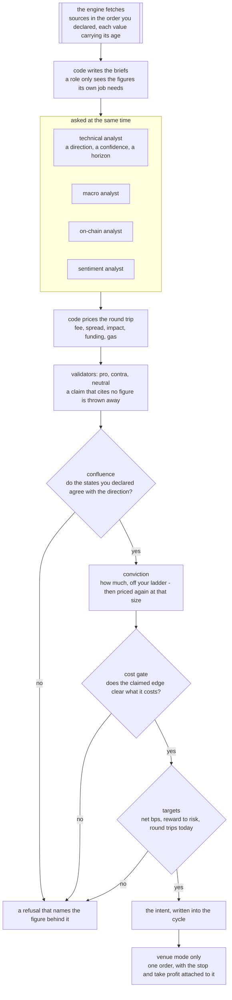
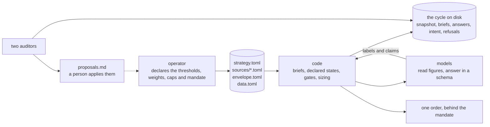
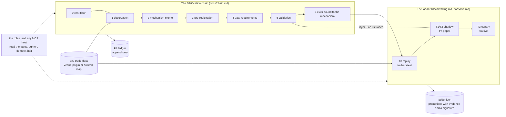
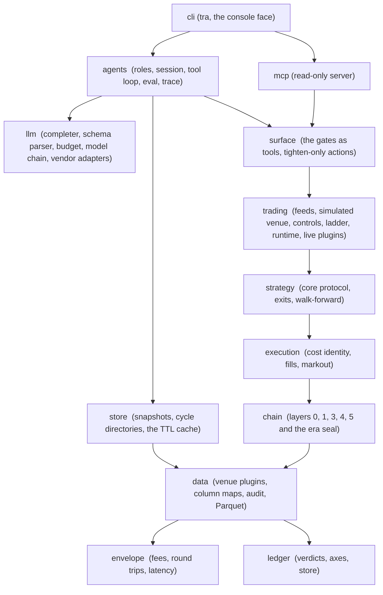

# trading-research-agents

**Autonomous trading agents for crypto that can't fudge their own results.**

Models decide; code checks the arithmetic. An engine fetches the data, tidies it up, and hands each
agent a short brief of figures it did not work out for itself. The agents read those figures and say
what they think. From there it's all code: the round trip is priced before an order exists, your own
limits are applied, and every intent, refusal and fill is written down in a file nobody rewrites
later. No model touches the order path, no agent holds a key, and the default venue is a simulator.
Ideas that survive all that are worth a look. The ones that don't are kept too, with the reason they
died.

It's a pre-release and the API still moves. It isn't on PyPI yet. What runs today: the whole
autonomous cycle, live data with free and paid sources, four analysts and three validators, the
confluence matrix, conviction sizing, the cost gate, your own targets, venue execution behind a
mandate you sign, and two auditors. Next up: the release pass - packaging and the first tag.

---

## One cycle

```bash
# Not on PyPI yet, so install from the source tree. `uv tool install` puts `tra` on your PATH:
git clone https://github.com/BijectiveLabs/trading-research-agents && cd trading-research-agents
uv tool install --editable . --with 'ccxt>=4.5' --with 'openai>=1' --with 'pyarrow>=18'

tra init my-desk --profile autonomous && cd my-desk   # the cycle, wired, commented line by line
cp .env.example .env                # your model key; no venue key is needed for a cycle
tra run --env-file .env             # one autonomous cycle, in the sandbox
```

The three `--with` extras are the SDKs this project talks through, and each one buys something
specific: `ccxt` is live venue data and, later, execution; `openai` is the client every
OpenAI-compatible provider uses (Groq, DeepSeek, xAI, OpenRouter, a local server); `pyarrow` is the
dataset format `tra data get` writes. Add `--with 'anthropic>=1'` or `--with 'google-genai>=1'` for
those providers. `tra check` names a missing one before a cycle spends anything finding out.

Without `uv`: `pip install -e '.[ccxt,openai,data]'` inside a virtual environment does the same,
and `tra` is then on that environment's PATH.



Four of those steps only run if you ask for them. The validators, the confluence matrix, the
conviction ladder and the targets are all empty until you declare them, and a fresh project has the
ladder and the targets filled in and the other two waiting. Everything else always happens.

What that prints, from a real cycle on live data with a real model:

```
cycle 2026-09-27T14-51-23Z BTCUSDT: 8.46s of agents
  funding        ccxt:bybit         age 0.764s
  ohlcv          ccxt:bybit         age 35.705s
  orderbook      ccxt:bybit         age 5.303s
technical: long at 0.68 over 3 bars: short-horizon reversion of the close against its window
           triggered by a zscore of -2.197, vwap_gap_bps of -24.21 and volume_ratio 2.392
cost: 13.48 bps round trip, 2.00 of it estimated
gate: 25.0000 bps claimed clears 13.4800 bps cost plus 0.0000 bps margin
the edge is declared: [agents].magnitude_bps, declared by the operator and not measured here
  fee_round_trip        11.0000 bps  declared
  spread_cost            0.0118 bps  measured
  impact                 0.0000 bps  computed
  funding_accrual        0.4682 bps  declared
  latency_slippage       2.0000 bps  estimated
intent: long 0.01 (sandbox)
```

And the same cycle in a terminal, with the panels the console draws:


Three things in that output carry the whole idea. The model never worked out a number: every
figure it read was computed by code from a snapshot that says how old it is. Eleven of the thirteen
basis points of cost are the venue's own fees, printed before an order exists. And the edge is
labelled a declaration, because nobody has measured it yet - you said it, so we show it as yours.
`docs/cycle.md` has the rest.

## If you'd rather backtest first

The cycle above decides on live figures. If you want to see the machinery on recorded data before
you point it at anything live, that's four commands and no key at all:

```bash
tra init my-run && cd my-run          # a project with an example core instead of an agent
tra data get BTCUSDT 2025-01-01       # fetch a day, audit it, write Parquet and funding into data/
tra check                             # what's ready, what's missing
tra backtest                          # that day, net of costs
```

Every file `tra init` writes is commented line by line, and nothing in the logic is a constant you
can't see. The same commands take you to paper trading (`tra paper`) and, once the ladder says so,
to a small live session (`tra live`, `docs/live.md`). From install to a first backtest is a few
minutes, most of it the download.

### `tra check` tells you what's left to do


Type `tra` on its own and you get the cockpit above: what's ready, what isn't, and the one command
to type next. `tra check` is the same thing as a plain list. Between them, that's the whole of the
setup you have to keep in your head. Here's a project made by `tra init --profile autonomous`, about
a minute old, before anyone has touched it:

```
ok    strategy.toml: valid; core 'agent-pending'; instrument BTCUSDT
ok    sources: derivatives, macro, news, onchain, sentiment on the shelf, nothing declared yet;
      fill one in and its analyst joins the roster
ok    roster: technical_analyst; `tra run` asks these
ok    channel: bybit/taker-taker enters as a taker, priced at that fee; an order crosses the book
ok    execution: sandbox; nothing leaves the machine
ok    conviction: floor 0.4; ladder 0.75+ -> 1.0x, 0.55+ -> 0.5x, 0.4+ -> 0.25x
ok    targets: at least 5 bps net; at most 6 round trips a day
ok    data.toml: chains for ohlcv, orderbook, funding, open_interest; `tra run` uses them
ok    symbols: BTCUSDT is BTC/USDT:USDT to the sources
ok    venues: fees are priced on bybit, data also comes from binance; deliberate is fine
todo  no dataset for BTCUSDT in data: run `tra data get BTCUSDT YYYY-MM-DD`
todo  funding: none; a run that spans a settlement will refuse (tra data get fetches it)
todo  [agents].provider is still the placeholder; name the provider you have a key for
3 thing(s) to fix first
```

Three things to do, each one named. Once they're done, `tra run` decides once, and
`tra run --every 5m` keeps deciding as each bar closes until the budget runs out, you touch the kill
switch, or you stop it yourself. Your key goes in `.env` next to the config and every command picks
it up from there - no flag needed.

## Why this exists

Most trading-agent projects are good at producing a decision and quiet about whether the decision
was earned. They carry no cost model, they hold nothing out, and they can't tell you which of their
past calls were wrong or why.

This one starts from the other end. It grew out of a research programme that closed thirty
hypotheses in four months without putting capital behind any of them, and wrote down what each one
died of. The agents inherit that habit as code:

- **Cost first.** A 3.0 bps signal with a perfect p-value is still dead against a 9.0 bps round
  trip. That comparison is layer 0, and it runs before anything else does.
- **Net from day one.** Fees, spread, slippage and funding are in every figure. Gross numbers are
  shown, labelled as gross, and never carry a verdict.
- **Power before verdict.** A result with too little data is `NOT PROVEN`, not `FALSIFIED`. They're
  different words on purpose: one of them is a branch nobody actually closed.
- **Reversal points.** When fees kill a verdict, the fee at which it comes back is written down, so
  the next reader with a better schedule reuses the work instead of redoing it.
- **Fewer agents, more gates.** Models write the mechanism memo, the falsifiable claim and the exit
  design. The arithmetic and the statistics are code, and code doesn't argue.

Two required dependencies: `numpy` and `rich`. No orchestration framework, no dataframe library,
nothing you can't swap. Anything touching money is `Decimal`; the statistics run in floating point
once the series has collapsed to numbers.

## Who is asked, and what each one may do

Each role reads figures that code worked out, answers inside a fixed shape, and decides nothing on
its own. Everything after the decision is arithmetic over the numbers you declared.

| Role | Reads | Answers | May never |
|---|---|---|---|
| technical analyst | closed candles, spread, funding | a direction, a confidence, a horizon | size the trade |
| macro analyst | dated levels and rates, dated text | a regime | propose a direction |
| on-chain analyst | chain figures and derivative figures | accumulation, distribution or neutral | propose a direction |
| sentiment analyst | dated scores, dated notes | negative, neutral, positive, or not declared | invent a mood no figure supports |
| validators (three stances) | the proposal and the figures behind it | support, oppose or abstain, with cited claims | claim a figure it was not given |
| technology auditor | the cycles this project recorded | findings and proposed changes | change anything |
| quant auditor | the desk's own decisions and round trips | findings and proposed changes | change anything |



The arrow that isn't there is the point: no model reaches the order, and no model edits your
files.

## How it fits together



An idea comes in at layer 0 and dies at the cheapest layer that can kill it. Whatever survives is
a decision core, and the same runtime carries it from replay to a small live session, one rung at a
time. The ledger keeps every death, the ladder every promotion. Models sit on the surface of all
this: they read what the gates measured, and the only thing they can do to a limit is make it
tighter.



Imports only ever point downward, and a test keeps them honest (`tests/test_boundaries.py`). `llm`
is the only package that talks to a model vendor, and it knows nothing about markets. `agents` is
the only package that talks to `llm`. The only places a venue is named by name are the plugin
directories and the files `tra init` copies into your project.

## What is here today

| Package | Purpose |
|---|---|
| `trading_research_agents.ledger` | The kill ledger: a closed vocabulary of verdicts and axes, an append-only store, and the consistency rules between them |
| `trading_research_agents.envelope` | The operating envelope: fees per channel, measured round trips, latency. Configuration, never constants |
| `trading_research_agents.data` | The data gate: any trade data to canonical trades, through a venue plugin or a declared column map; a one-pass audit with findings, a manifest with checksums, and exact `DECIMAL` Parquet with the `[data]` extra |
| `trading_research_agents.data.sources` | Live sources behind a chain: free before paid, failover recorded, a time to live per kind, and provenance on every value. `ccxt:<venue>` reads public endpoints of more than a hundred venues and is never given a key |
| `trading_research_agents.strategy` | The decision-core protocol, exits bound to the mechanism (layer 6, causal stops with adverse fills), the walk-forward harness that refuses precomputed parameters. No strategy of its own |
| `trading_research_agents.trading` | The trading agent: recorded feeds and live feed plugins, a simulated venue on the execution rules, controls that fail closed, the promotion ladder, one runtime for replay and shadow |
| `trading_research_agents.store` | What a run remembers: the snapshot a cycle is decided from with provenance and age on every value, the cycle directory an auditor replays, and a cache that only returns what is still fresh |
| `trading_research_agents.llm` | Everything that talks to a language model and nothing that decides: the completer protocol, the structured-output parser, the call budget with `usage.jsonl`, and the vendor adapters behind `[anthropic]`, `[openai]`, `[google]` plus verified OpenAI-compatible presets |
| `trading_research_agents.agents` | The roles: what each agent is asked, what it may answer, and what it may never do. Seven today (screener, technical analyst as a decision core, macro, on-chain, risk manager, executor, auditor) in a fixed session, a bounded tool loop, model comparison, and traces |
| `trading_research_agents.surface` | The gates as callable tools for the MCP server and the roles: ten reads, and actions that only tighten, demote or halt |
| `trading_research_agents.cli` | The `tra` command: run, data, chain, agent, trade, ladder, ledger, and the console face |
| `trading_research_agents.chain` | The falsification chain: layer 0 (cost floor), layer 1 (market observation), layer 3 (sealed pre-registration), layer 4 (data requirements), layer 5 (validation: net returns, block bootstrap, matched null, subperiods, power, BH, anchor robustness), and the era seal |
| `trading_research_agents.execution` | Execution realism: the cost identity with funding, walk-the-book, passive fills with trade-through, effective cost across unfilled orders, markout, and the pre-trade cost a cycle is gated on |

Layer 0 in six lines:

```python
from decimal import Decimal
from trading_research_agents.envelope import load_envelope
from trading_research_agents.chain import cost_floor

envelope = load_envelope("examples/envelope.toml")
check = cost_floor(envelope, Decimal("3.0"), venue="hyperliquid")
print(check.outcome, check.margin_bps)
```

A stop at layer 0 becomes a `CLOSED` row on the cost axis, envelope-bound, with the reversal
point recorded. A pass records nothing, because clearing the cheapest test is not a verdict.

## Command line

The same gates from a shell. Exit code 0 means the gate was cleared, 1 means it said no, 2 is
a usage error; add `--json` to any command for machine-readable output.

```bash
tra data get BTCUSDT 2025-01-01                 # fetch + audit + Parquet + funding
tra check                                        # what is ready, what is missing
tra data fetch --venue binance --instrument BTCUSDT --month 2025-01 --out data/
tra data audit data/BTCUSDT-trades-2025-01.zip --venue binance --instrument BTCUSDT \
    --max-gap 5m --manifest data/manifest.json
tra data audit export.csv --mapping examples/mapping.toml --instrument BTCUSDT --max-gap 5m
tra data pull BTCUSDT                            # one live snapshot through the chains in data.toml
tra run --env-file .env                          # one autonomous cycle; docs/cycle.md
tra chain floor --envelope examples/envelope.toml --magnitude 3.0 --venue hyperliquid     --subject "informed-flow burst drift" --ledger ledger.jsonl --id H-001
tra chain observe --dataset data/BTCUSDT-2025-01-01.parquet   # layer 1: does the event recur? observation.toml
tra chain check preregistration.json
tra ledger show
tra agent propose --idea "Longs paying high funding get squeezed into settlement"     --envelope examples/envelope.toml --provider anthropic
tra agent refusals
tra chain requirements --registration runs/<id>/preregistration.json --manifest data/manifest.json
tra chain validate --registration runs/<id>/preregistration.json --trades trades.jsonl \
    --cost-bps 15.0 --block-length 7 --ledger ledger.jsonl --id V-001
tra init my-run                                  # or: --agent deepseek --model deepseek-flash
tra backtest                                     # config, envelope, dataset, out: by convention
tra paper
tra ladder promote --evidence "layer 5 OPEN on backtest-1" --signed-by operator
tra data funding --venue bybit --instrument BTCUSDT --from 2025-01-01 --to 2025-01-31 \
    --out funding.json
tra live --env-file .env                        # canary tier, behind the ladder; docs/live.md
tra mcp serve                               # the read gates for any agent host; docs/mcp.md
tra agent session --env-file .env               # the seven roles over data/; docs/agents.md
tra agent eval --model groq:openai/gpt-oss-120b --model deepseek:deepseek-flash --env-file .env
tra agent trace runs/session-1                  # the record of a run or a session, in order
```

`data fetch` streams the archive to a `.part` file, hashes it as it arrives, and keeps it only
if the size and, where the venue publishes one, the checksum agree. `data audit` refuses a
dataset the way the gate would, and writes the manifest with the finding either way. A venue
is a plugin (`docs/venues.md`); data from anywhere else comes through a column map.

## Common conventions

The command names are the words people already use: `tra backtest` is replay (T0), `tra paper` is
shadow (T1/T2), `tra live` is the canary tier (T3). `tra init DIR` lays down a project -
`strategy.toml`, `envelope.toml`, `mapping.toml`, `data.toml`, the `sources/` shelf, an example core
beside the config, `.env.example`, `.gitignore`. The shelf is one file per class of data (macro,
news, sentiment, on-chain, derivatives), shipped as forms with the entries commented out: fill one
in and the analyst that reads it joins the roster; leave it alone and that role is never asked.

Inside a project you don't need flags. The commands pick up `strategy.toml` and `envelope.toml` from
the directory you're standing in, the newest dataset in `data/`, funding beside it, and they write
into `runs/`. Your keys come from the shell or from the `.env` next to the config, and nothing
outside those two places is ever read. Every flag still exists if you want to point somewhere else.
Venues, feeds and live adapters plug in through entry points, and the MCP server behind the `[mcp]`
extra hands the gates to any host as read-only tools.

At a terminal, `tra` on its own shows what's ready and the one command to type next. A run draws a
live panel of bars, intents, fills and net basis points; a session shows each role as it goes; every
report is a table. The numbers are the same ones the plain output carries, so nothing is hidden in
the pretty version: `--json` is untouched, and `--plain` (or `TRA_PLAIN=1`, or piping it anywhere)
gives you text.

## What the package does not contain

`docs/boundaries.md` spells out where this software stops and why: one order per decision and no
retries, no routing or execution algorithms, no account or treasury operations, no DEX execution (a
chain can be priced, not traded), no optimiser in the research chain, and no model that can size a
trade or edit a file. Every line there is a decision we made on purpose, not something we forgot,
and each one says what to do instead. The short version:

- **A strategy.** The machinery ships - the protocol, the exits, the walk-forward harness. The
  cores in `examples/strategies/` are examples, measured and closed in the research this came from,
  and a run points at them by file exactly the way it would point at yours.
- **A venue.** The two that ship are plugins found through the same registry as a
  third-party one. Nothing in the gates names a venue, and a test fails the build if it does.
- **A data vendor.** Any CSV with a declared column map goes through the same gate.
- **A model that can loosen a control.** The agents see everything - the data, the gates, and as
  the technical analyst, the decision on each bar. But the limits, the caps, the ladder and the kill
  switch are code, and a role can only tighten them, step one down, or pull the switch. The MCP
  server has no tool that trades, promotes or records. `docs/liability.md` says plainly where the
  responsibility sits.
- **A production tier.** Real orders exist at canary only, with hard caps, behind a ladder
  that needs evidence and a signature at every step and refuses production outright.
- **A book to manage.** This project executes one decision; a trading platform manages a
  portfolio across venues over time. Keeping the two apart is what lets this one stay small
  enough to read.

## Roadmap

| Release | Adds |
|---|---|
| 0.1 | Ledger, envelope, layer 0, pre-registration with numeric kill criteria, public-archive ingestion and dataset audit for two venues, `tra` CLI |
| 0.2 | The agent: bound, mechanism memo with a critic, and pre-registration drafted by a language model, validated by the existing gates, recorded to the ledger; bounded revision loop; Anthropic and OpenAI adapters |
| 0.3 | Execution realism: cost identity, latency-shifted fills, trade-through matching, fill probability, markout; layers 4 and 5 with the era seal |
| 0.4 | The trading agent: layer 6 exits, walk-forward harness, replay and shadow on one code path, controls, ladder, a live public feed (`[shadow]`) |
| 0.4.1 | Adoption rules: no strategy in the core, venues as plugins with entry points, any data through a column map |
| 0.5 | The canary tier: a live venue plugin behind a security review that runs as tests, hard caps, the ladder gate; funding as charged; MCP server exposing the read gates to any agent host; `tra init`, `backtest`, `paper`, `live` |
| 0.6 | Agents with full access through the gates: seven roles in a fixed session, the technical analyst as a metered decision core, providers as plugins with verified presets, `usage.jsonl`; the bounded tool loop, resume, eval and trace; layer 1 of the chain; the console face |
| 0.7 | Production tier behind an operational runbook; private execution stream; maker channels; a second live venue |

Crypto perpetuals first. The core vocabulary is market-agnostic (`venue`, `instrument`,
`session`), but every number in the gates was measured on crypto venues and nothing is promised
for other markets until it has been measured there too.

## Development

```bash
uv sync
uv run ruff check . && uv run ruff format --check .
uv run mypy
uv run pytest
```

See `CONTRIBUTING.md` for the branch flow and the standards the code is held to,
`docs/boundaries.md` for where this software stops and why, `docs/llm.md` for how models are used
(no framework, stateless roles, provider fallback, caching, batching, why no fine-tuning),
`docs/architecture.md` for the package boundaries and the file formats at them, `docs/data.md`
for the data gate, `docs/cycle.md` for the cycle, `docs/chain.md` for the chain, `docs/execution.md` for execution realism,
`docs/agent.md` for the research agent, `docs/trading.md` for the trading agent, and
`docs/ledger.md` for the verdict vocabulary.

## License

MIT. See `LICENSE`; `NOTICE` lists the third-party software this package builds on.

Built by [Bijective Labs](https://github.com/BijectiveLabs).
