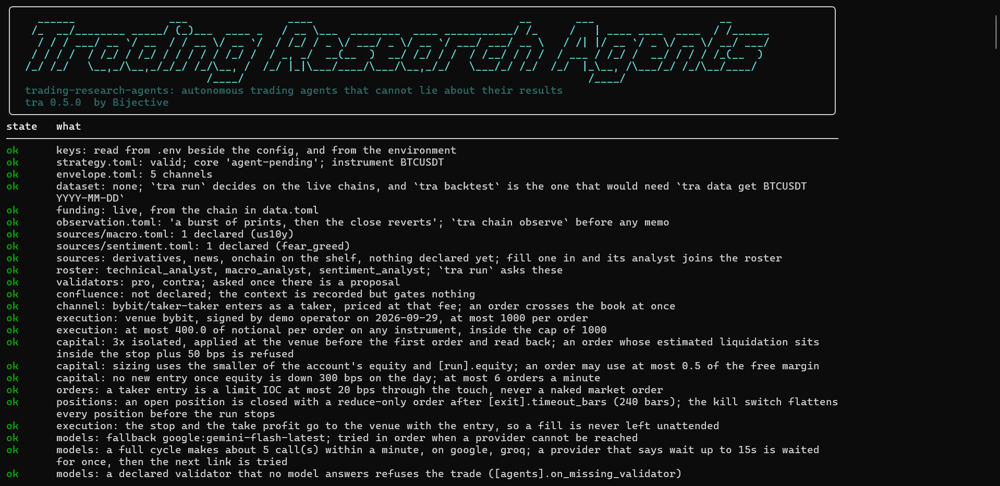
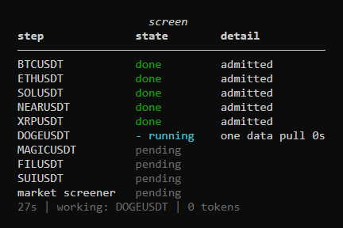
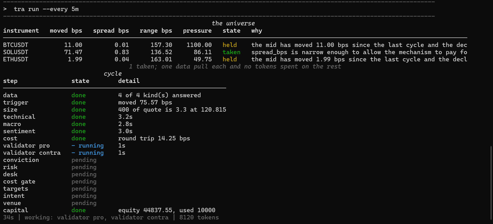
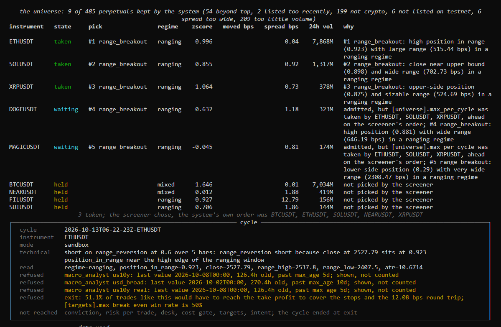
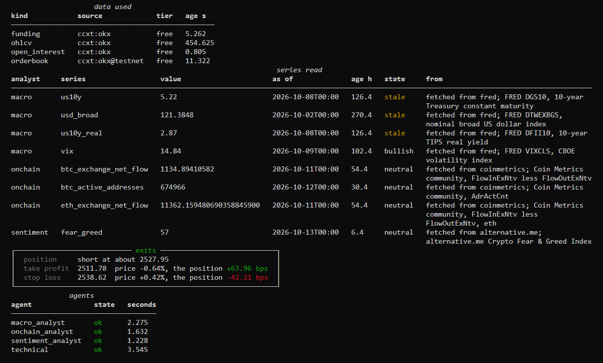
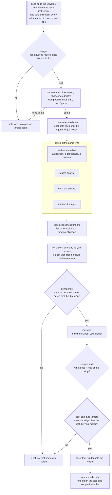

# trading-research-agents

**Autonomous trading agents for crypto that can't fudge their own results.**

Language models are good at reading a market and saying what they think. They are bad at
arithmetic, they don't know what a trade costs, and they will happily overrule a limit you set.
This project uses them for the first part only. Code fetches the data and works out every figure.
The agents read those figures and give an opinion. Then code prices the trade, applies your limits,
sizes it, and either writes it down or sends one order with the stop attached. Every decision and
every refusal is kept on disk with its reason, so you can check afterwards what happened and why.

It's a pre-release and isn't on PyPI yet. What works today: a universe of perpetuals found and
measured by code, a screener that picks where to look, the full autonomous cycle on live data, four
analysts and up to three validators, the gates that decide, sizing from your own rules, real orders
on a venue's practice environment behind a mandate you sign, and two auditors that read the records.

---

## Contents

- [What it solves](#what-it-solves)
- [Quick start](#quick-start)
- [What you see, in order](#what-you-see-in-order)
- [How one cycle decides](#how-one-cycle-decides)
- [Venues](#venues)
- [Models and providers](#models-and-providers)
- [From a replay to real orders](#from-a-replay-to-real-orders)
- [Your money, your orders, your positions](#your-money-your-orders-your-positions)
- [Watching a desk, and what is kept](#watching-a-desk-and-what-is-kept)
- [Command line](#command-line)
- [What it guarantees, and what is not built yet](#what-it-guarantees-and-what-is-not-built-yet)
- [Documentation](#documentation)

## What it solves

| The usual problem with trading agents | What happens here |
|---|---|
| The model invents or miscalculates a number | Models never compute. Every figure comes from code, and a figure a model cites is checked against its brief, value included. |
| Nobody knows what a trade cost until it's done | The round trip (fees, spread, impact, funding, slippage) is priced before an order exists, and a trade whose claimed edge doesn't clear it is refused. |
| The agent sizes its own position | Size comes from your conviction ladder and your risk limit. No model can make a trade bigger. |
| A model "decides" to ignore your settings | Your declared thresholds decide. A model's opinion is recorded beside them, never instead of them. |
| Something went wrong and there is no trace | Each cycle keeps its snapshot, briefs, answers, the intent and what the venue said. Nothing is rewritten. |
| A crash leaves a position with no stop | The stop and take profit go to the venue attached to the entry, so they survive this process dying. |

## Quick start

You need Python 3.11 or newer and [uv](https://docs.astral.sh/uv/).

```bash
git clone https://github.com/BijectiveLabs/trading-research-agents && cd trading-research-agents
uv tool install --editable . --with 'ccxt>=4.5' --with 'openai>=1' --with 'pyarrow>=18'

tra init my-desk --profile autonomous && cd my-desk
cp .env.example .env        # put your model key in here; no venue key is needed yet
tra check                   # what's ready, and the one thing to fix next
tra run                     # one autonomous cycle, in the sandbox: nothing leaves your machine
```

The `--with` extras are what the project talks through: `ccxt` for venue data and orders, `openai`
for every OpenAI-compatible provider (Groq, DeepSeek, xAI, OpenRouter, a local server), `pyarrow`
for datasets. Add `--with 'anthropic>=1'` or `--with 'google-genai>=1'` for those providers.
Without uv, `pip install -e '.[ccxt,openai,data]'` in a virtual environment does the same.

A project made by `tra init --profile autonomous` checks out like this before you touch it
(shortened):

```
ok    strategy.toml: valid; core 'agent-pending'; instrument BTCUSDT
ok    roster: technical_analyst; `tra run` asks these
ok    channel: bybit/taker-taker enters as a taker, priced at that fee; an order crosses the book at once
ok    execution: sandbox; nothing leaves the machine
ok    conviction: floor 0.4; ladder 0.75+ -> 1.0x, 0.55+ -> 0.5x, 0.4+ -> 0.25x
ok    targets: at least 5 bps net; at least 2.0x the round trip; at most 6 round trips a day
ok    risk per trade: 50 bps of equity at the stop, applied to every size the ladder produces
ok    size: 0.01 in base units, step 0.001
ok    data.toml: chains for ohlcv, orderbook, funding, open_interest; `tra run` uses them
todo  [agents].provider is still the placeholder; name the provider you have a key for, and its model
1 thing(s) to fix first
```

Name your provider and model in `strategy.toml` (see [Models and providers](#models-and-providers))
and `tra run` decides once. `tra run --every 5m` keeps deciding: the first pass runs now, then one
every five minutes on the clock (:00, :05, :10 and so on), so the wait after a pass is whatever is
left to the next mark, and the desk tells you the time it ends at.

Type `tra` on its own inside the desk and you get the console, which is the next section.

## What you see, in order

**1. The console.** Run `tra` inside your desk and it opens the cockpit: what is ready, what isn't,
and the next command to run. Under it is a prompt that takes every command and draws it right
there. Arrow keys go back through what you typed, tab completes, `help` lists the commands and
`exit` leaves. For scripts and cron, `tra -c "run --now"` runs one command and exits.



**2. The pass over your instruments.** Type `run --every 5m` and the desk first refreshes any data
series that are due, one line each. Then it looks at every instrument on your list, one data pull
apiece, and measures it. The screen steps through them live:



**3. One cycle per instrument it takes.** Code found the candidates and measured them; the screener
chose among them and cited each instrument's own figures; code's own order is kept beside the
choice. The instruments taken get a full cycle. The terminal shows the whole pipeline from the
start and updates it as each step begins and ends. Steps that run at the same time spin at the same
time, each with its own clock, and the line underneath says who is working right now:



**4. The result.** When the cycle finishes, the table gives way to the pass over the universe, what
was taken and what was held and why, then the data the cycle used and what the round trip costs:



After that, what each validator argued, how conviction weighed the analysts, the risk at the stop,
and whether the trade clears the desk's targets:



**5. Between cycles.** The desk says when the next pass is, on the clock and in minutes, for
example `next pass at 14:30:00 UTC, in 10m 57s`, and counts down to it. An auditor woken by an alarm
gets a spinner of its own.

The same cycle as plain text (`--plain`, a pipe or a log), from a real run on live data, shortened:

```
cycle 2026-09-29T02-59-16Z BTCUSDT: 5.344s of agents, 15.042s of validators
  funding        ccxt:bybit         age 4.267s
  ohlcv          ccxt:bybit         age 32.746s
  orderbook      ccxt:bybit         age 7.544s
macro      risk-off: the operator declared a bullish state for US10Y; measured correlation is
           neutral (0.0) on a modest sample, weak evidence that does not overturn the declaration
sentiment  positive: declared state is bullish, and the measured figures both support it
technical: long on range_reversion at 0.65 over 5 bars: the close is stretched low in the window
read: zscore=-0.587, vwap_gap_bps=-3.99, ret_1_bps=1.59
validator contra   oppose on 2 cited figure(s)
validator pro      support on 3 cited figure(s)
conviction: 0.800 of 1.0 (macro 1.0, sentiment 0.5, technical 1.300)
risk: 8.29 bps of equity at the stop against the declared 50 bps, size 0.010
cost: 12.87 bps round trip, 2.00 of it estimated
gate: 25.0000 bps claimed clears 12.8723 bps cost plus 0.0000 bps margin
  refused targets: the claimed edge is 1.94x the round trip and the desk declared 2.0x;
                   the cost is certain and the edge is not
```

That trade was refused. It cleared the cost gate and still died, because this desk asks for an edge
of twice the cost and got 1.94 times. A refusal names the figure behind it, every time.

## How one cycle decides



Who does what:

| Role | Reads | Answers | Can never |
|---|---|---|---|
| technical analyst | candles, spread, funding, book imbalance, open interest change, and the regime on its timeframe and the higher ones you declare | a direction, a setup from a fixed list, a confidence, a horizon | size the trade, or run a trend setup in a range |
| macro analyst | dated rates and levels, dated text | risk-on, risk-off or neutral | propose a direction |
| on-chain analyst | chain and derivatives figures | accumulation, distribution or neutral | propose a direction |
| sentiment analyst | dated scores and notes you curate | negative, neutral, positive, or not declared | invent a mood no figure supports |
| market screener | what code measured for each admitted instrument: move, spread, regime, volume, correlation to BTC | which instruments to take, in what order, citing their figures | add an instrument code did not admit |
| validators (pro, contra, neutral) | the proposal and the figures behind it | support, oppose or abstain, with cited claims | decide, or cite a figure it wasn't given |
| technology and quant auditors | the cycles this desk recorded | findings and proposed changes | change anything |

The macro, on-chain and sentiment analysts read dated series you declare under `sources/`. Each one
is either a file you keep or a feed the desk refreshes itself (FRED, the Crypto Fear & Greed Index,
or any paid vendor that answers JSON over https). `tra sources show` lists every series with where it
came from and how old its last value is, and a value older than its `max_age` is shown as stale and
never counted. [Data sources](https://docs.bijectivelabs.dev/opensource/sources) has the details.

Which validators run is yours to declare. A vote never decides on its own: it moves conviction by
the weight you give it (`[conviction].validator_weight`), and a stance counts for what it says beyond
its assignment, since a pro that supports is expected to.

Analysts are allowed to disagree. Each one's view becomes a score between -1 and 1, computed from
its own figures against the lines you drew, so a macro reading barely past its line counts as a small
voice and one far past it counts as a big one. Conviction adds them up: agreement grows the size,
opposition shrinks it in proportion, and only opposition that outweighs the case stops the trade. A
short at 0.70 confidence against a barely bullish macro and sentiment scores 0.56 and trades at half
size; against a strongly bullish context it scores 0 and doesn't trade.

The technical analyst knows what kind of market it is working in before it decides. Code measures
the regime on its timeframe (trending up, trending down, ranging or mixed) and on the higher
timeframes you list in `[run].context_intervals`, and it hands over what your macro thresholds say
this cycle as well. A setup that doesn't fit the regime, such as a trend trade in a sideways
market, is refused by name; `[regime]` holds the lines.

Everything after the analysts is arithmetic over numbers you declared. No model can place, cancel or
resize an order, read a file outside the project, or edit your configuration. [Agents](https://docs.bijectivelabs.dev/opensource/agents) has
the full table of what an agent can reach, and [The cycle](https://docs.bijectivelabs.dev/opensource/cycle) walks through every step.

## Venues

A cycle reaches venues through ccxt. Here is what that means in practice today:

| Venue | What a cycle can do there | Practice environment | Run end to end by us |
|---|---|---|---|
| **Bybit** (the default) | everything: orders with the stop and take profit attached | demo, testnet | **yes**, on demo: real orders, exits attached, a resting order cancelled |
| OKX, Bitget, BingX, KuCoin Futures, Hyperliquid | everything | varies, see `tra venues` | not yet |
| Binance, Deribit, HTX, Gate, MEXC | orders, but you carry the stop yourself (`exits = "none"`) | varies | not yet |
| Kraken, Kraken Futures, Phemex | data only: they can't report the position, so no order is sent | | |

"Everything" means ccxt reports the five things a safe order needs: send it, attach the exits, read
the position, read the open orders, cancel. Only Bybit has been run end to end with real orders, so
treat every other venue as untested: start on its practice environment and read what it sends.

Adding the venue you trade on is four steps, and one command writes most of it:

```bash
tra venues okx            # what it can do, and which keys it signs with
tra venues okx --setup    # the blocks to paste into envelope.toml, data.toml, strategy.toml and .env
```

The setup leaves your fees blank on purpose, because a guessed fee would price every trade wrong,
and the file won't load until you fill them in. [Venues](https://docs.bijectivelabs.dev/opensource/venues) has the full table, the keys each
venue needs, and the four steps.

## Models and providers

You choose the provider and the model; nothing is hard-coded. Each provider reads its key from the
environment (or the `.env` beside your config) and nowhere else.

| Provider | Key in `.env` | Install with | Structured output | Tested live here |
|---|---|---|---|---|
| `groq` | `GROQ_API_KEY` | `openai` | JSON schema, falling back to JSON mode; checked by code | **yes**: `openai/gpt-oss-120b` and `openai/gpt-oss-20b`, every live cycle in our records |
| `google` | `GEMINI_API_KEY` or `GOOGLE_API_KEY` | `google-genai` | JSON schema | **yes**: `gemini-flash-latest`, as the fallback |
| `anthropic` | `ANTHROPIC_API_KEY` | `anthropic` | JSON schema | unit-tested; default model `claude-opus-5-5` |
| `openai` | `OPENAI_API_KEY` | `openai` | strict JSON schema | unit-tested |
| `deepseek` | `DEEPSEEK_API_KEY` | `openai` | JSON mode | preset only |
| `mistral` | `MISTRAL_API_KEY` | `openai` | JSON schema | preset only |
| `xai` | `XAI_API_KEY` | `openai` | JSON mode | preset only |
| `openrouter` | `OPENROUTER_API_KEY` | `openai` | JSON mode | preset only |
| `qwen` | `DASHSCOPE_API_KEY` | `openai` | JSON mode | preset only; pass `--base-url` for your region |
| `ollama` | none | `openai` | JSON mode | preset only; a local server |
| `local` | none | `openai` | JSON mode | any OpenAI-compatible server; pass `--base-url` |
| `9router` | `9ROUTER_API_KEY` | `openai` | JSON schema | preset only; a local router |

Whatever the provider, every answer is parsed against a closed schema by code before anyone reads
it, so a model that only offers JSON mode is held to the same shape as one with strict schemas.

```toml
[agents]
provider = "groq"
model = "openai/gpt-oss-120b"
effort = "medium"                    # minimal | low | medium | high | xhigh | max, where the
                                     # vendor takes it; left out, the vendor's default applies
fallback = ["google:gemini-flash-latest", "anthropic:claude-opus-5-5"]

[agents.roles.sentiment_analyst]     # a role that only labels can run on a cheaper model
model = "a-cheaper-model"
effort = "low"
```

`fallback` is tried in order when a provider is rate limited or down, with the same brief. A vendor's
free tier meters each model on its own, so roles can share a provider across two models and each
model keeps its own allowance; `tra check` judges the load per model and says when one is too much. Every
call is a line in `usage.jsonl` with its tokens and latency, and nothing caps spend unless you
declare a ceiling. `tra keys --probe` proves each key works without sending a prompt. A vendor of
your own is about thirty lines ([Model providers](https://docs.bijectivelabs.dev/opensource/providers)).

## From a replay to real orders

What it trades: **linear perpetual futures** (USDT- or USDC-margined swaps) on any venue ccxt
reaches, long and short, with the leverage and margin mode you declare. Spot, dated futures,
inverse contracts and options are not built yet; until they are, venue mode checks the market type
on every order and refuses anything that is not a linear perpetual. [Boundaries](https://docs.bijectivelabs.dev/opensource/boundaries) says what
adding one would take.

You can stop at any of these steps. Each is one command, and each was run end to end before this
README was written.

| Step | Command | What happens | Needs |
|---|---|---|---|
| 1. Replay | `tra data get BTCUSDT 2025-01-01`, then `tra backtest` | a day of the venue's own archive, checksum-verified and audited, replayed net of every cost | nothing |
| 2. Shadow | `tra paper --minutes 30` | the live public feed, decisions recorded, nothing sent | nothing |
| 3. Canary | `tra live` | a small live session behind hard caps and the ladder | a venue key, a promotion with evidence |
| 4. Agents | `tra run` | the cycle above instead of a code core; sandbox until you say otherwise | a model key |
| 5. Venue mode | `tra run` with `[execution].mode = "venue"` | one order per decision, exits attached, positions looked after | a signed `MANDATE.md`, the canary tier, caps, a leverage, venue keys |

The replay of that day printed `net -294.19 bps` for the example core, and it is shown as it came
out: a backtest that only shows good news is one nobody should believe.

Venue mode is the only mode that can lose money, so it has a door in front of it. `tra mandate`
prints the text you have to keep in your project word for word, and `tra check` names every missing
piece.

### Your money, your orders, your positions

Once orders flow, three things look after the money, all of them code and none of them a model:

| Before an order | When it is sent | While it is open |
|---|---|---|
| the account's real equity and free margin are read | your leverage is applied at the venue and read back | at the start of every pass, each position is checked against the venue |
| sizing uses the smaller of the real equity and what you allow the desk | an order whose liquidation would sit inside its stop is refused | one that outlives its hold limit is closed with a reduce-only order |
| an order may use only part of the free margin | a taker entry is a limit IOC within your slippage band, never a naked market order | one the venue's stop or take profit closed is written up with its real fees and funding |
| a day's loss past your limit stops new entries | the stop and take profit go with the entry, so they outlive this process | the kill switch flattens everything before the desk stops |

Who decides what, in one line each: **the analysts propose the direction, your risk rule sets the
size, you choose the leverage, and no model touches the last two.** Leverage never makes a trade
bigger. It only decides how much margin the trade ties up and how far away liquidation sits.

```toml
[execution]
mode = "venue"
leverage = 3                     # the one setting you must choose; everything else has a default
margin_mode = "isolated"         # isolated | cross
hold_limit = "timeout"           # close by time after [exit].timeout_bars; or horizon, or none
```

Underneath, on every venue: the order goes only to the environment you declared (demo, testnet or
mainnet); an open position or a working order refuses a second entry; a size off the venue's step is
refused rather than rounded; a clock more than a second off the venue's refuses before anything is
signed; and Ctrl-C or a service stop cancels a resting order before the process leaves. Every close
goes to `positions.jsonl` and every finished trade to `round_trips.jsonl`. [Capital, orders and positions](https://docs.bijectivelabs.dev/opensource/capital) has
every setting, every refusal and the arithmetic behind each one.

One thing to know before you rely on it: the position checks run at the start of each pass of
`tra run --every`. With no desk running, an open position has its venue-side stop and take profit
and nothing else, so a desk meant to run unattended belongs under a supervisor.

Orders cross the book by default (`taker-taker`): they always fill, which is how most desks trade.
Point `[run].venue_key` at a `maker-taker` channel and entries rest on the book as post-only orders
instead - a lower fee, fewer fills, since a resting order can be left behind by the market. Either
way the cost gate prices the fee of the channel you chose.

## Watching a desk, and what is kept

The console runs commands in its own process, so closing it ends what it was running. A desk that
should keep running belongs under a supervisor (systemd, a service manager, `tmux`), and then you
look at it from anywhere with:

```bash
tra watch --every 5s       # a read-only view built from the records the desk writes
```

`tra watch` opens no connection, holds no key and takes no lock, so opening and closing it does
nothing to the desk.

What is kept, and where:

| What | Where | Notes |
|---|---|---|
| everything one cycle did | `runs/cycles/<id>/` | snapshot, briefs, answers, intent, `placed.json`, `cycle.json`, and `inputs.json.gz` with the raw inputs; `cycle.json` holds a sha256 of each file |
| the pass over the universe | `runs/screens/` | every instrument measured, what the screener chose and why |
| every model call | `runs/cycles/usage.jsonl` | tokens, latency, price |
| when the desk ran and what stopped it | `runs/cycles/scheduler.jsonl` | one line per start and stop |
| every position closed, by time, by the venue or by the kill switch | `runs/cycles/positions.jsonl` | venue mode |
| every finished trade with entry, exit, fees and funding | `runs/cycles/round_trips.jsonl` | venue mode; what the quant auditor reads |
| the first equity reading of each day | `runs/cycles/equity.jsonl` | what the daily loss limit is measured from |
| what you typed at the prompt | `.tra-history` | a convenience only; `tra -c` keeps none |

## Command line

Every command says what it did. Exit code 0 means cleared, 1 means a gate said no, 2 is a usage
error. `--json` gives machine-readable output and `--plain` gives text instead of panels.

**Getting started**

| Command | What it does |
|---|---|
| `tra` | opens the console |
| `tra init my-desk --profile autonomous` | a project wired for the agents, every file commented |
| `tra check` | every setting read against the others, with what to fix |
| `tra keys --probe` | proves every key works; no key is printed, no prompt or order sent |
| `tra venues okx --setup` | what a venue can do, and the blocks to paste to trade on it |
| `tra mandate` | the text venue mode requires: `tra mandate > MANDATE.md` |

**Running**

| Command | What it does |
|---|---|
| `tra run` | one autonomous cycle |
| `tra run --every 5m --cycles 12` | twelve scheduled passes: the first now, then one on every fifth minute of the clock |
| `tra run --now` | ask the roster even if the trigger would have held a quiet market |
| `tra watch --every 5s` | a read-only view of a running desk |
| `tra audit` | both auditors over the records; nothing is applied |
| `tra backtest`, `tra paper`, `tra live` | replay, shadow, canary |

**Data**

| Command | What it does |
|---|---|
| `tra data get BTCUSDT 2025-01-01` | download a day, verify its checksum, audit it, write Parquet and funding |
| `tra data audit export.csv --mapping mapping.toml` | your own CSV, through the same audit |
| `tra data pull BTCUSDT` | one live snapshot through the chains in `data.toml` |
| `tra sources show`, `tra sources pull` | where the reading analysts' series come from and how old they are; refresh them now |
| `tra universe` | which perpetuals discovery finds on the venue now, and what each filter took out |
| `tra runs verify` | every cycle's files against their hashes, and its briefs against its raw inputs |
| `tra runs prune --keep 90d` | what old cycle directories would be removed; add `--yes` (and `--archive`) to do it |

**The ladder, research and hosts**

| Command | What it does |
|---|---|
| `tra ladder show`, `promote`, `demote` | which tier the desk stands at; one step up with evidence, or down |
| `tra chain floor`, `observe`, `check`, `validate` | the research chain, layer by layer ([The falsification chain](https://docs.bijectivelabs.dev/opensource/chain)) |
| `tra ledger show` | every idea that died, and what killed it |
| `tra agent session`, `eval`, `trace` | the research session, model comparison, a run read back |
| `tra mcp serve` | the read-only gates as tools for any MCP host |

## What it guarantees, and what is not built yet

Some rules are guarantees, enforced by code and tests, and every change has to keep them:

- **No model touches an order or a key.** Models read figures and answer; code sizes, prices,
  limits and sends.
- **No model can loosen a control.** A model can tighten a limit, step the ladder down or arm the
  kill switch; never widen, promote or disarm.
- **One decision, at most one order.** A venue error is recorded and the next cycle decides again;
  nothing is retried around real capital.
- **Stale or missing data is refused,** never read as zero or as current.

Other things are simply not built yet, and contributions are welcome: spot, inverse, dated futures
and options; decentralised venues; more than one account; transfers and treasury; routing and
execution algorithms; portfolio accounting. [Boundaries](https://docs.bijectivelabs.dev/opensource/boundaries) lists each one with what it does
today and what a contribution would need. The example strategy cores are examples: your edge is
yours to declare.

[Liability](https://docs.bijectivelabs.dev/opensource/liability) says plainly where responsibility sits when real capital is involved.

## Documentation

The full documentation is at [docs.bijectivelabs.dev](https://docs.bijectivelabs.dev). Its source is in
`docs/`, so a change in behaviour and the page that describes it go in the same pull request.

| Read this | For |
|---|---|
| [The cycle](https://docs.bijectivelabs.dev/opensource/cycle) | the cycle step by step, and every setting that shapes it |
| [Agents](https://docs.bijectivelabs.dev/opensource/agents) | each role, what it reads, and what an agent can and cannot reach |
| [Data sources](https://docs.bijectivelabs.dev/opensource/sources) | where the macro, on-chain and sentiment figures come from, fetching them, and freshness |
| [Capital, orders and positions](https://docs.bijectivelabs.dev/opensource/capital) | equity, margin, leverage, liquidation, daily loss, time exits, the kill switch, and the records they leave |
| [Venues](https://docs.bijectivelabs.dev/opensource/venues) | which venues work, and adding yours |
| [Working with language models](https://docs.bijectivelabs.dev/opensource/llm), [Model providers](https://docs.bijectivelabs.dev/opensource/providers) | how models are used: fallback, spend, adding a provider |
| [The live tier](https://docs.bijectivelabs.dev/opensource/live), [The trading agent](https://docs.bijectivelabs.dev/opensource/trading) | the ladder from replay to a live session |
| [The data gate](https://docs.bijectivelabs.dev/opensource/data) | the data gate, and bringing your own data |
| [Boundaries](https://docs.bijectivelabs.dev/opensource/boundaries), [Liability](https://docs.bijectivelabs.dev/opensource/liability) | what is guaranteed, what is not built yet, and who is responsible |
| [The agent](https://docs.bijectivelabs.dev/opensource/agent), [The MCP server](https://docs.bijectivelabs.dev/opensource/mcp) | the research agent, and the MCP server |
| [Architecture](https://docs.bijectivelabs.dev/opensource/architecture) | packages, import rules, file formats |
| [The falsification chain](https://docs.bijectivelabs.dev/opensource/chain), [Execution realism](https://docs.bijectivelabs.dev/opensource/execution), [The kill ledger](https://docs.bijectivelabs.dev/opensource/ledger) | the research chain, execution realism, verdicts |
| [Command line](https://docs.bijectivelabs.dev/opensource/commands) | every `tra` command |
| `CHANGELOG.md` | what changed |

## Development

```bash
uv sync
uv run ruff check . && uv run ruff format --check .
uv run mypy
uv run pytest
```

`CONTRIBUTING.md` has the branch flow and the standards the code is held to.

## License

MIT. See `LICENSE`; `NOTICE` lists the third-party software this package builds on.

Built by [Bijective Labs](https://github.com/BijectiveLabs).
