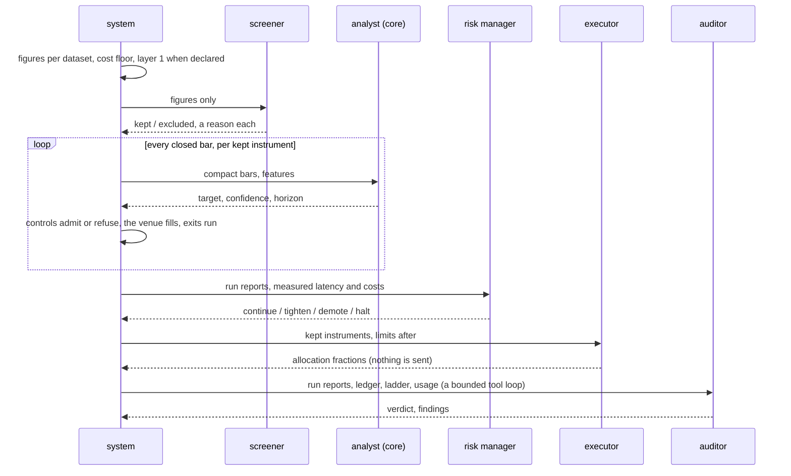

# Architecture

The product is one chain of gates. A claim about a strategy passes the data gate, the
falsification chain and the execution gate, in that order, before the agent may say it. This
page fixes the package boundaries, the direction of dependency, and the files that cross
those boundaries. The Python API is allowed to change before 1.0; the file formats are the
contract.

## Packages

```
trading_research_agents/
  records/     how every record reaches the disk: crash-safe appends, atomic
               writes, hashes, the per-day cycle index                          depends on nothing
  extras.py    how to add a missing optional dependency, worded once            depends on nothing
  ledger/      verdict vocabulary, axes, transferability, kill-ledger rows      depends on nothing
  envelope/    operator parameters: fees per channel, latency, venue access     depends on nothing
  data/        any trade data to Parquet, dataset audit, manifest; venue
               archive plugins in data/venues, column maps for the rest      -> ledger, envelope
  chain/       falsification chain, layers 0 to 5                               -> ledger, envelope, data
  execution/   cost identity, fills after latency, trade-through matching,
               fill probability, markout                                        -> ledger, envelope, data, chain
  strategy/    the core protocol, exits bound to the mechanism, the walk-forward
               harness; no strategy of its own                                 -> everything above
  trading/     the live feed through ccxt in trading/feeds, simulated venue, the
               live venue through ccxt in trading/venues, controls, canary caps,
               ladder, the runtime                                                     -> everything above
  llm/         language-model providers, fallback chains, usage ledger        depends on nothing
  store/       snapshots and cycle directories                                  -> everything above, llm
  surface/     the gates as callable tools, read tools and tightening actions
               (listed on the MCP page); shared by mcp and agents                -> everything above
  agents/      the research roles at layers 0, 2 and 3; the session roles; the
               cycle and its analysts, validators and screener                  -> everything above, llm, store, surface
  mcp/         the gates as MCP tools                                            -> everything except agent
  cli/         the `tra` command                                                 -> everything
```

Rules, each enforced by a test in `tests/test_boundaries.py`:

1. `ledger` and `envelope` import nothing else from this project. They are vocabulary.
2. Arrows point only downward through the list. `chain` does not know `execution` exists; layer 5
   takes the cost of a trade as a function argument, and `execution` supplies one.
3. Only `llm/providers` imports a vendor SDK. Layers 0, 1, 4, 5 and 7 are arithmetic and
   statistics and have no path to a model.
4. Source files are ASCII.
5. No class in the package implements `Strategy` or `FittedCore`. Decision cores live in
   [`examples/strategies/`](https://github.com/BijectiveLabs/trading-research-agents/blob/master/examples/strategies/) or in the operator's own package, and the package never imports
   an example.
6. No module outside `data/venues/`, `trading/feeds/` and `trading/venues/` names a venue.
7. `mcp` reaches everything except `agent`, and its tools only read.
8. The only actions on `surface` tighten a limit, step the ladder down, or arm the kill
   switch. A role holding the surface holds nothing that loosens.

## Adoption rules

Five rules decide what goes into the package and what stays outside it. They exist so the
software can be adopted without inheriting the particular strategies, venues or vendors of
the research it descends from.

1. **No strategy in the core.** The package ships the mechanism (the protocol, the exits, the
   walk-forward harness) and no strategy. What [`examples/strategies/`](https://github.com/BijectiveLabs/trading-research-agents/blob/master/examples/strategies/) holds is an example of
   the mechanism, not a recommendation, and a run points at it by file like it would at any
   other core. Rule 5 above enforces it.
2. **Venues are plugins.** Archive layouts and live feeds are found through a registry and
   an entry point group; the two that ship are plugins like any other. The gates, the
   chain, the runtime and the agent do not know which venue a run is on. Rule 6 enforces it;
   [Venues](/opensource/venues) says how to add one.
3. **The data gate takes any data.** A venue archive through its plugin, or any CSV through a
   declared column map ([`examples/mapping.toml`](https://github.com/BijectiveLabs/trading-research-agents/blob/master/examples/mapping.toml)), ends in the same audit, the same manifest
   and the same Parquet. Nothing about where a row came from changes what the gate demands
   of it.
4. **Agents are a surface, with full access.** The roles and the MCP tools call the gates;
   they never are the gates. A model may decide (the technical analyst is a decision core);
   the system executes and refuses (controls, caps, ladder, kill switch). Rules 3 and 8 enforce it.
5. **Every market is one shape.** A market is read once from ccxt's unified market structure
   into `trading.market.Market`: its type, what it settles in, whether it trades in contracts
   and how large one is, its fees and its minimum. A spot pair, a perpetual, a dated future, an
   option and a prediction outcome are the same type with different facts, so the order path
   asks the market what applies (contracts, margin, leverage) rather than branching per venue or
   per market type. Which types venue mode sends to today is one list in `trading/dispatch.py`;
   [Boundaries](/opensource/boundaries) says why the rest wait.

Not every package exists yet. The list is the plan; a package is added when its first gate
lands with tests. Today: `ledger`, `envelope`, `data`, `chain`, `execution`, `strategy`,
`trading`, `llm`, `store`, `agents`, `mcp`, `cli` (with `cli/tui.py`, the console face on `rich`, which reads reports and decides nothing). Outside the package: `examples/` (an envelope, a run
config, a column map, two example cores), never imported by it; `templates/` inside the
package is a copy of those examples that `tra init` writes into a new project, and is never
imported either.

## One system, every venue

The desk does not carry an adapter per exchange. It speaks to every venue through ccxt, and
everything ccxt reports is turned into the package's own types once, at the edge. Past that edge
a venue is a name in the settings, and the parts below work the same for all of them.

| Part | What it does | Where |
|---|---|---|
| Data | candles, books, funding and open interest from any venue ccxt supports, chained with fallbacks | `data/sources/` |
| Market | one shape for every market type, read from ccxt's unified market | `trading/market.py` |
| Order | the entry, its exits attached, one per decision, under a client id from the cycle | `trading/dispatch.py` |
| Execution | a taker entry as a limit IOC inside a slippage band, a maker entry post-only with a timeout | `trading/dispatch.py` |
| Order state | waits for the fill, cancels what is left, and records what the venue said in its own words | `trading/dispatch.py` |
| Position | reconciled with the venue on every pass; closed by time or by the kill switch, reduce-only | `trading/positions.py` |
| Account | equity, free margin, the margin an order ties up, the day's loss and the drawdown | `trading/capital.py` |

It is deliberately small. It holds what an autonomous desk needs to send an order safely and know
afterwards what happened, and no more; a full order and portfolio platform is a different product.

`tra live`, the research ladder's canary tier, sends through the same client and hand as venue
mode, so the order path is one path whichever command sends, and the public trade stream that
`tra trade shadow` and `tra live` read is ccxt's too. What is left venue by venue is what ccxt does
not unify: the historical trade archives in `data/venues/`, and the account checks in
`trading/venues/accounts.py`.

## The session, as it runs



The macro and on-chain analysts, when series are declared, are asked between the screener
and the runs; their briefs are measured by the system and carry no action.

## The chain

| Layer | Test | Dies here when | Cost to run | Status |
|---|---|---|---|---|
| 0 | Cost floor | plausible magnitude below the cheapest round trip | minutes | implemented |
| 1 | Market observation | the phenomenon does not recur | minutes | implemented (`tra chain observe`) |
| 2 | Mechanism memo | nobody can be named who is structurally forced to lose | minutes | implemented (model writes, the system checks the form, a critic objects once) |
| 3 | Pre-registration | the claim cannot be stated so data could refute it | hours | implemented |
| 4 | Data requirements | no available instrument can measure the premise | hours to days | implemented |
| 5 | Statistical validation | interval spans zero, loses to a matched null, or lives in one subperiod | days | implemented |
| 6 | Strategy design | the exit is not bound to the mechanism | weeks | implemented |
| 7 | Shadow | net expectation negative in the live market, zero orders placed | weeks of calendar | implemented (`tra paper`, then layer 5 on its trades) |
| 8 | Live capital | the venue does not behave as the simulation assumed | capital | canary tier only (`tra live`), hard caps, behind the ladder |

The chain is strictly ordered by cost. A hypothesis does not reach layer 5 because somebody is
confident about it.

## Files at the boundaries

| Artefact | Format | Minimum content |
|---|---|---|
| Dataset | Parquet; price and quantity as `DECIMAL(38, s)` with `s` the instrument's scale; timestamps UTC nanoseconds | trades: `ts`, `venue`, `instrument`, `price`, `qty`, `side`, `trade_id`, `seq` |
| `manifest.json` | JSON | schema version, venue, instrument, UTC range, source files with SHA-256, normaliser version, audit verdict, creation time |
| `preregistration.json` | JSON, sealed by content hash | mechanism, claim, metric, horizon, universe, era, cost model, power, kill criteria; amendments are separate dated files referencing the original hash and may never loosen a threshold or move a horizon |
| `ledger.jsonl` | JSON Lines, append-only | one row per entry; nothing is rewritten; a retraction is a new `WITHDRAWN` row naming the row it retracts |
| `envelope.toml` | TOML | one `[[channel]]` per venue and execution channel; see [`examples/envelope.toml`](https://github.com/BijectiveLabs/trading-research-agents/blob/master/examples/envelope.toml) |
| `trades.jsonl` | JSON Lines | layer 5 input: `instrument`, `entry_ts_ns`, `exit_ts_ns`, `direction`, `weight`, `gross_return_bps`, numbers as decimal strings |
| `validation.json` | JSON | layer 5 output: interval, null report, subperiods, power, metrics, the decision with every fired criterion, the registration seal and the trades hash |
| `seal.json` | JSON, written once | era, opened_at, specification hash, gates |
| `strategy.toml` | TOML | a run of the trading agent: the core by file or import, exit rule, run settings, controls; see [`examples/strategy.toml`](https://github.com/BijectiveLabs/trading-research-agents/blob/master/examples/strategy.toml) |
| `mapping.toml` | TOML | a column map that takes any CSV through the data gate; see [`examples/mapping.toml`](https://github.com/BijectiveLabs/trading-research-agents/blob/master/examples/mapping.toml) |
| `intents.jsonl`, `fills.jsonl` | JSON Lines | every intent with its admission decision; every simulated fill |
| `ladder.json` | JSON | current tier and the history of promotions (with evidence and signature) and demotions (with reason) |
| `funding.json` | JSON | settlement timestamps (epoch ns) to rates as fractions, the measured interval, the venue and the range; written by `tra data funding`, read by `[run].funding` |
| `preflight.json` | JSON | what a live venue checked before the first print: clock skew, key permissions, position adopted |
| `usage.jsonl` | JSON Lines | one model call per line: role, provider, model, tokens, latency, declared cost, outcome |
| `cycle.json` | JSON | one cycle: data, agents, gates, intent, placement, refusals, and `files`, a sha256 per file in the cycle directory |
| `inputs.json.gz` | gzip JSON, schema 1 | a cycle's raw inputs as fetched (candles per timeframe, book levels, funding, open interest) and the settings its briefs used |
| `index/<day>.jsonl` | JSON Lines | one line per cycle: id, instrument, mid, held, intent, placement, open interest, and the sha256 of `cycle.json`; the last line for a cycle wins |
| `session.json`, `audit.json` | JSON | a session of the seven roles: what was kept and why, the runs, the risk decision and the limits after it, the allocation, the auditor's verdict |

## Numbers

- Basis points to one decimal place, leading minus for negatives, never parentheses.
- Times in UTC, always stated as such. A naive datetime is refused.
- Prices, quantities, fees and costs are `Decimal`. Floats appear only in statistics.
- Every quantity that carries a verdict is reported as a triple: point estimate, interval,
  sample size.

## What the platform boundary looks like

This project is consumed by other systems through the files above and nothing else. It does
not import from, link to, or know about any proprietary trading platform. A system that wants
its research tier gated by these rules reads the Parquet, the manifest and the ledger.
