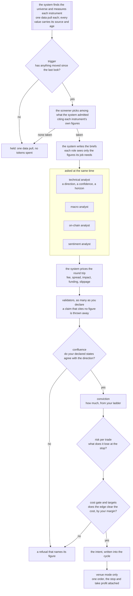

# trading-research-agents

**Autonomous trading agents for crypto that can't fudge their own results.**

Language models are good at reading a market and saying what they think. They are bad at
arithmetic, they don't know what a trade costs, and they will happily overrule a limit you set.
This project uses them for the first part only. The system itself, fixed rules with no model
involved, fetches the data and works out every figure. The agents read those figures and give an
opinion. Then the system prices the trade, applies your limits, sizes it, and either writes it
down or sends one order with the stop attached. Every decision and every refusal is kept on disk
with its reason, so you can check afterwards what happened and why.

It is a pre-release. What works today: a universe of perpetuals found and measured by the system, a
screener that picks where to look, the full autonomous cycle on live data, four analysts and up to
three validators, the gates that decide, sizing from your own rules, real orders on a venue's
practice environment behind a mandate you sign, and two auditors that read the records.

The command is `tra`. Start with the [quick start](/opensource/quick-start).

## What it solves

| The usual problem with trading agents | What happens here |
|---|---|
| The model invents or miscalculates a number | Models never compute. Every figure comes from the system, and a figure a model cites is checked against its brief, value included. |
| Nobody knows what a trade cost until it's done | The round trip (fees, spread, impact, funding, slippage) is priced before an order exists, and a trade whose claimed edge doesn't clear it is refused. |
| The agent sizes its own position | Size comes from your conviction ladder and your risk limit. No model can make a trade bigger. |
| A model "decides" to ignore your settings | Your declared thresholds decide. A model's opinion is recorded beside them, never instead of them. |
| Something went wrong and there is no trace | Each cycle keeps its snapshot, briefs, answers, the intent and what the venue said. Nothing is rewritten. |
| A crash leaves a position with no stop | The stop and take profit go to the venue attached to the entry, so they survive this process dying. |

## How one cycle decides

## Who does what

| Role | Reads | Answers | Can never |
|---|---|---|---|
| technical analyst | candles, spread, funding, book imbalance, open interest change, and the regime on its timeframe and the higher ones you declare | a direction, a setup from a fixed list, a confidence, a horizon | size the trade, or run a trend setup in a range |
| macro analyst | dated rates and levels, dated text | risk-on, risk-off or neutral | propose a direction |
| on-chain analyst | chain and derivatives figures | accumulation, distribution or neutral | propose a direction |
| sentiment analyst | dated scores and notes you curate | negative, neutral, positive, or not declared | invent a mood no figure supports |
| market screener | what the system measured for each admitted instrument: move, spread, regime, volume, correlation to BTC | which instruments to take, in what order, citing their figures | add an instrument the system did not admit |
| validators (pro, contra, neutral) | the proposal and the figures behind it | support, oppose or abstain, with cited claims | decide, or cite a figure it wasn't given |
| technology and quant auditors | the cycles this desk recorded | findings and proposed changes | change anything |

Everything after the analysts is arithmetic over numbers you declared. No model can place, cancel
or resize an order, read a file outside the project, or edit your configuration. [Agents](/opensource/agents)
has the full table of what an agent can reach, and [The cycle](/opensource/cycle) walks through every step.

## What it trades

**Linear perpetual futures** (USDT- or USDC-margined swaps) on any venue ccxt reaches, long and
short, with the leverage and margin mode you declare. Spot, dated futures, inverse contracts and
options are not built yet; until they are, venue mode checks the market type on every order and
refuses anything that is not a linear perpetual. [Boundaries](/opensource/boundaries) lists what
is guaranteed, what is not built yet, and what adding each piece would take.

## Where to go next

| If you want to | Read |
|---|---|
| install it and run a first cycle | [Quick start](/opensource/quick-start) |
| see what the terminal shows, step by step | [What you see](/opensource/what-you-see) |
| understand every step and every setting | [The cycle](/opensource/cycle) |
| point it at your own data feeds, free or paid | [Data sources](/opensource/sources) |
| trade on a venue | [Venues](/opensource/venues) and [Capital, orders and positions](/opensource/capital) |
| choose a model provider | [Model providers](/opensource/providers) |
| find a command | [Command line](/opensource/commands) |
| contribute | [Contributing](/opensource/contributing) |
