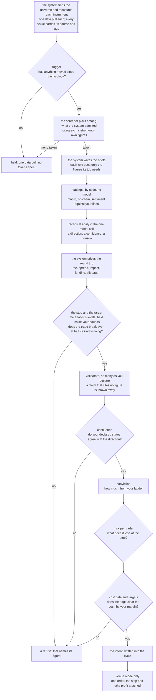

# TRA

**Autonomous trading agents with deterministic execution. The agents propose; the system decides.**

TRA (trading research agents) is published as `bitra` on PyPI and runs as `tra`. Before
0.10.1 the package was called `trading-research-agents`, and the same package is still
published under that name.

Language models are good at reading a market and saying what they think. They are bad at
arithmetic, they don't know what a trade costs, and they will happily overrule a limit you set.
This project uses them for the first part only. The system itself, fixed rules with no model
involved, fetches the data and works out every figure. The agents read those figures and give an
opinion. Then the system prices the trade, applies your limits, sizes it, and either writes it
down or sends one order with the stop attached. Every decision and every refusal is kept on disk
with its reason, so you can check afterwards what happened and why.

It is an early release, so expect settings to change between versions. What works
today: linear perpetuals, spot pairs (stock perpetuals and tokenized stocks among them) and
prediction market outcomes through one order path, a universe of perpetuals found and measured by
the system, a screener that picks where to look, the full autonomous cycle on live data, one analyst that proposes, three readings of
your own series computed by code, up to three validators, stops and
targets the analyst names inside bounds you set, the gates that decide, sizing from your own rules,
real orders on a venue's practice environment behind a mandate you sign, a risk manager that can
only make the desk more careful, and two auditors that read the records.

The command is `tra`. Start with the [quick start](/opensource/quick-start).

## What it solves

| The usual problem with trading agents | What happens here |
|---|---|
| The model invents or miscalculates a number | Models never compute. Every figure comes from the system, and a figure a model cites is checked against its brief, value included. |
| Nobody knows what a trade cost until it's done | The round trip (fees, spread, impact, funding, slippage) is priced before an order exists, and a trade whose claimed edge doesn't clear it is refused. |
| The agent sizes its own position | Size comes from your conviction ladder and your risk limit. No model can make a trade bigger. |
| A model "decides" to ignore your settings | Your declared thresholds decide. A model's opinion is recorded beside them, never instead of them. |
| Something went wrong and there is no trace | Each cycle keeps its snapshot, briefs, answers, the intent and what the venue said. Nothing is rewritten. |
| A crash leaves a position with no stop | The stop and take profit go to the venue with the entry, or right after the fill where the venue takes them no other way, so they survive this process dying. |
| Text from a feed tells the model what to do | The model that proposes a direction reads numbers code computed; outside text reaches no model at all, and no model can send an order or reach a key. |

None of these is hypothetical. [Why it is built this way](/opensource/why) lists the documented
failures behind each one, with their sources.

## How one cycle decides

## Who does what

| Role | Reads | Answers | Can never |
|---|---|---|---|
| technical analyst | candles, spread, funding, book imbalance, open interest change, and the regime on its timeframe and the higher ones you declare | a direction, a setup from a fixed list, a confidence, a horizon, and where its stop and target sit | size the trade, place a level outside your `[exit]` bounds, run a trend setup in a range, or fade a market that is not a measured range |
| macro, on-chain and sentiment readings (code, not agents) | dated rates and levels, chain and derivatives figures, scores and notes you curate | a declared state and a graded score: each series against the lines you drew | ask a model, or propose a direction |
| market screener | what the system measured for each admitted instrument: move, spread, regime, volume, correlation to BTC | which instruments to take, in what order, citing their figures | add an instrument the system did not admit |
| validators: pro and contra | the proposal and the figures behind it, each without the other's case | the strongest case for or against, as cited claims | see the other side's case, or cite a figure it wasn't given |
| validator: neutral, as judge | the same, and both cases once code has checked every claim | support, oppose or abstain, the one verdict that counts | see the advocates' verdicts, or count claims instead of weighing them |
| risk manager | what the run recorded: round trips, the losing streak, your limits, the alarm that woke it | continue, cut the size of new entries, pause instruments, or halt, each for a stated number of hours | loosen a limit you set, or add size |
| technology and quant auditors | the cycles this desk recorded | findings and proposed changes | change anything |

Everything after the models answer is arithmetic over numbers you declared. No model can place, cancel
or resize an order, read a file outside the project, or edit your configuration. [Agents](/opensource/agents)
has the full table of what an agent can reach, and [The cycle](/opensource/cycle) walks through every step.

## What it trades

Today, through one order path and the same gates:

| Market | How | Run |
|---|---|---|
| Linear perpetuals (USDT- or USDC-margined swaps) | long and short, with the leverage and margin mode you declare; the default | end to end on the demo or testnet APIs of Bybit, OKX, Bitget, BingX, Binance and Gate |
| Spot pairs | long only, paid in full; list `spot` in `[execution].markets` | the order path and a desk cycle on the Bybit and OKX demos |
| Stock perpetuals and tokenized stocks | a perpetual and a spot pair to the venue, entered only while the underlying's session trades | a stock perpetual on the OKX demo, a tokenized stock on the Bybit demo |
| Prediction market outcomes | long only, decided on a probability by the event analyst and priced to resolution; list `prediction` | sandbox cycles on live data; the order path is tested against ccxt's shapes |

Every exchange ccxt supports is reached through that same path, and any other can have its run on
its demo or testnet API at any time ([Venues](/opensource/venues),
[Exchange accounts and keys](/opensource/exchange-keys)).

That is where the project started, not where it stops. Dated futures, inverse contracts and options
are on the way, each with its own cost model, exit rules and tests. Until a market type has those,
venue mode checks the type on every order and refuses it, because a market the system cannot
yet price and protect is not one it should send to. [Boundaries](/opensource/boundaries) lists what
is guaranteed, what is not built yet, and what adding each piece would take.

## Where it is going

The project is in active development, and these pages describe where it stands today.

- **More market types:** spot, stock perpetuals, tokenized stocks and prediction markets are
  built; inverse and dated futures and options follow, each with its own cost model, exit rules, sizing
  and tests before venue mode accepts it.
- **More venues run end to end:** each joins the six already run after a full run on its demo or
  testnet API, ours or yours.
- **The rest of the not-built-yet list** in [Boundaries](/opensource/boundaries), one piece at a
  time, without weakening a guarantee.

**Use the release.** What PyPI installs is the latest release, and these docs describe it. Releases
come from `master`. The `develop` branch is where the next release is built: it moves often, a
commit there is not a release, and it can carry work that is unfinished or changed again before it
ships. A set of changes becomes a release when it is merged into `master`, tagged and published; the
[changelog](https://github.com/BijectiveLabs/bitra/blob/master/CHANGELOG.md) says
what each one brought.

## Where to go next

| If you want to | Read |
|---|---|
| install it and run a first cycle | [Quick start](/opensource/quick-start) |
| see what the terminal shows, step by step | [What you see](/opensource/what-you-see) |
| understand every step and every setting | [The cycle](/opensource/cycle) |
| point it at your own data feeds, free or paid | [Data sources](/opensource/sources) |
| trade on a venue | [Venues](/opensource/venues) and [Capital, orders and positions](/opensource/capital) |
| choose a model provider | [Model providers](/opensource/providers) |
| find a command | [Command line](/opensource/commands) |
| contribute | [Contributing](/opensource/contributing) |
