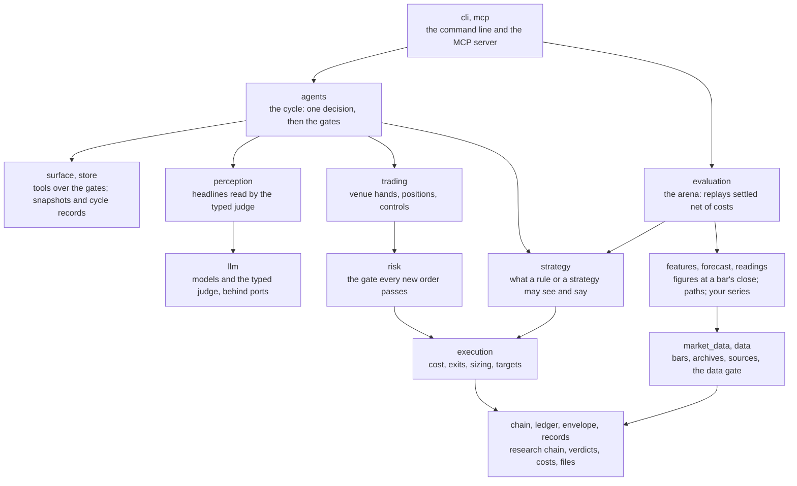

# Source

One package lives here, `trading_research_agents`. It is installed as `bitra` and imported under
its own name; the CLI is `tra`. The package name predates the PyPI name and is kept so that
imports written against earlier releases keep working.

## Layers

Each subpackage may import only the ones beneath it. `tests/test_boundaries.py` reads every import
and fails the build on one that reaches up, so this map is enforced, not described.

## Where to start reading

| To understand | Read |
|---|---|
| one cycle, from snapshot to intent | `agents/cycle/run.py`, then `decide.py` and `gates.py` |
| a rule as the decision | `strategy/core.py` (`Rule`, `Idea`), `agents/cycle/rule.py`, `evaluation/rule_row.py` |
| the event guard and the typed judge | `agents/cycle/event_guard.py`, `perception/`, `llm/judge.py` |
| what a trade costs and where its exits go | `execution/cost.py`, `execution/pretrade.py`, `execution/stops.py` |
| the gate in front of every order | `risk/` |
| an order on a venue, and an unanswered one | `trading/dispatch.py`, `trading/venues/` |
| the arena | `evaluation/arena.py`, `evaluation/settle.py`, `evaluation/baselines.py` |
| the market archive | `market_data/archive.py`, `market_data/klines.py` |

## Subpackages

| Package | Holds |
|---|---|
| `agents` | the cycle and its roles: what each is asked, what it may answer, and what it may never do |
| `chain` | the falsification chain: the ways an idea can die, cheapest test first |
| `cli` | the `tra` command |
| `data` | the data gate, dated series and text, and the sources a desk reads from |
| `envelope` | what execution costs for this operator, per channel |
| `evaluation` | the arena: policies and rules replayed over the archive, settled net of costs |
| `execution` | execution realism: cost, exits, sizing, targets, the trigger |
| `features` | figures a decision reads, computed at a bar's close from what was known then |
| `forecast` | the paths and the calibrated forecast: how likely a take comes before a stop |
| `ledger` | the kill ledger: a closed vocabulary and an append-only record of every test |
| `llm` | everything that talks to a language model or the typed judge, and nothing that decides |
| `market_data` | order flow, book, derivatives and text, minute by minute or hour by hour, into a verified archive |
| `mcp` | the gates as MCP tools |
| `perception` | archived headlines read by the typed judge into events, and the event guard's arithmetic |
| `readings` | your own series read against your own thresholds, with no model |
| `records` | how every record is written to disk and read back |
| `risk` | the risk gate: one entry point every new order passes, failing closed |
| `store` | snapshots of what a run saw, cycle directories, a cache |
| `strategy` | the mechanism a rule or a strategy runs under; the package ships no strategy |
| `surface` | the gates as callable tools, for the MCP server and the roles |
| `templates` | the files `tra init` writes into a new desk; copies of `examples/`, never imported |
| `trading` | the venue hands, positions, the kill switch and the controls that fail closed |
